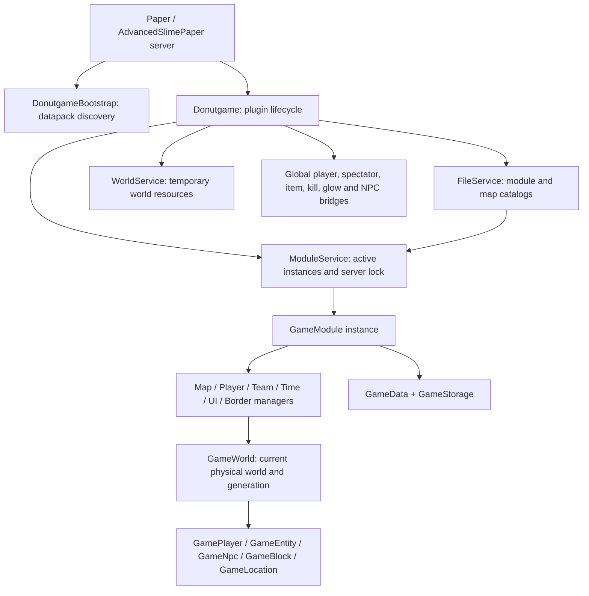
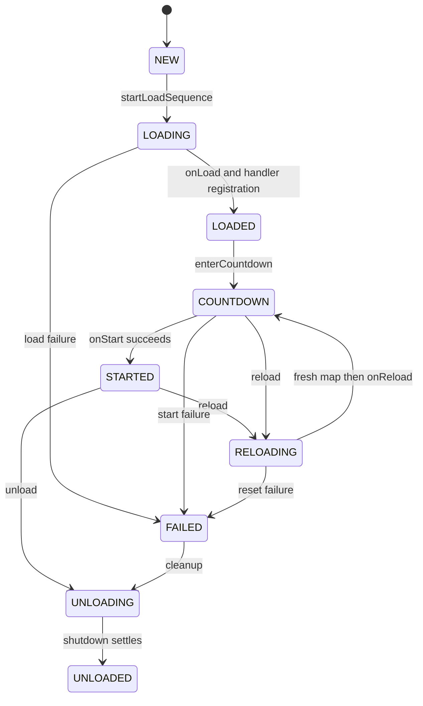

# Donutgame architecture and subsystem rewrite guide

Source snapshot: branch `reset`, commit `fea07c56320969a57785dd22bffe23cbdf596d68`, inspected November 22, 2026.

This is a source-based explanation of the existing implementation and a plan for rebuilding it yourself, starting at `Donutgame.java`. **Existing behavior** describes what the code does. **Rewrite guidance** and **checkpoints** describe a suggested new implementation; they are not claims that the existing code already has those properties. The final appendix indexes the source files and their declared methods so you can navigate the reference branch while working on one subsystem.

## Contents

1. [The system as a whole](#1-the-system-as-a-whole)
2. [Build and repository structure](#2-build-and-repository-structure)
3. [Rewrite sequence and dependency strategy](#3-rewrite-sequence-and-dependency-strategy)
4. [Plugin entry point and global service lifecycle](#4-plugin-entry-point-and-global-service-lifecycle)
5. [Module discovery, configuration, files, and storage](#5-module-discovery-configuration-files-and-storage)
6. [Module instance lifecycle and administrative commands](#6-module-instance-lifecycle-and-administrative-commands)
7. [Maps, world instances, geometry, and block operations](#7-maps-world-instances-geometry-and-block-operations)
8. [Players, state ownership, joining, leaving, and reconnecting](#8-players-state-ownership-joining-leaving-and-reconnecting)
9. [Scoped entities, events, and the module API boundary](#9-scoped-entities-events-and-the-module-api-boundary)
10. [Timers and scheduling](#10-timers-and-scheduling)
11. [Spectators and respawning](#11-spectators-and-respawning)
12. [Teams, scoreboards, collisions, and glow](#12-teams-scoreboards-collisions-and-glow)
13. [Items, loot, custom components, and datapacks](#13-items-loot-custom-components-and-datapacks)
14. [UI, sound, titles, and sidebars](#14-ui-sound-titles-and-sidebars)
15. [Borders and particle geometry](#15-borders-and-particle-geometry)
16. [NPCs and navigation](#16-npcs-and-navigation)
17. [Damage attribution and kill feedback](#17-damage-attribution-and-kill-feedback)
18. [Void Wars](#18-void-wars)
19. [Speed Zone](#19-speed-zone)
20. [Zone Wars](#20-zone-wars)
21. [Doppelganger](#21-doppelganger)
22. [Cross-system flows and state lifetimes](#22-cross-system-flows-and-state-lifetimes)
23. [Known limitations and rewrite decisions](#23-known-limitations-and-rewrite-decisions)
24. [Verification and practical completion checklist](#24-verification-and-practical-completion-checklist)
25. [Source and method index](#25-source-and-method-index)

## 1. The system as a whole

Donutgame is a Paper minigame framework plus four separately compiled game modules. The root project is the actual server plugin. Modules are ordinary JARs discovered by that plugin, loaded through `URLClassLoader`, and instantiated as subclasses of `internal.game.GameModule`. They are not separate Bukkit plugins.

The central abstraction is **one active module instance owns one replaceable world and a set of managers**. Multiple instances of the same game type can exist, subject to the root configuration's `max_active_games`. Each instance has a numeric `index`; the module's `id` identifies its game type, resources, and persistent database. Do not confuse those two identities.



There are three important layers:

| Layer | Responsibility | Examples |
| --- | --- | --- |
| Global plugin services | Server integration and resources shared across games | `FileService`, `ModuleService`, `WorldService`, `PlayerWorldStateService`, `GlowService`, `SpectatorService`, `GameNpcService` |
| Per-instance framework | Ownership, lifetime, and reusable gameplay capabilities | `GameModule`, `GameWorld`, all six managers, `GameEventRegistrar`, `GameStorage` |
| Game rules | Teams, win conditions, round events, loadouts, checkpoints | `VoidWars`, `SpeedZone`, `ZoneWars`, `Doppelganger` and their helpers |

Much of the framework exists to prevent state from leaking between games, maps, spectator sessions, or the ordinary server world. A successful rewrite must preserve those ownership rules, not just reproduce method names.

## 2. Build and repository structure

| Path | Purpose |
| --- | --- |
| `src/main/java/com/donutsforlife11/donutgame/Donutgame.java` | Main `JavaPlugin`, composition root |
| `src/main/java/com/donutsforlife11/donutgame/DonutgameBootstrap.java` | Early datapack discovery before normal enable |
| `src/main/java/com/donutsforlife11/donutgame/api/` | Module-facing wrappers, managers, and value types |
| `src/main/java/com/donutsforlife11/donutgame/internal/` | Server adapters, resource loading, lifecycle implementation |
| `src/main/java/com/donutsforlife11/donutgame/commands/` | Brigadier commands and inline config parsing |
| `src/main/resources/` | Root `config.yml` and `paper-plugin.yml` |
| `modules/{void_wars,speed_zone,zone_wars,doppelganger}/` | Independent game JAR projects and resources |
| `buildSrc/src/main/java/` | Source generators and compiler-based API checks |
| `src/test/java/` | Executable state and persistence checks |
| `src/test/module-boundary/` | Compile-time allow/reject fixtures |
| `docs.md` | Existing API-oriented reference; useful alongside implementation |
| `modules/speed_zone/MAP_METADATA.md` | Course and checkpoint modifier schema |
| `lava_run.md` | Proposed game behavior; **there is no Lava Run module implementation** |

### Build contracts

`settings.gradle.kts` automatically includes directories under `modules/` containing `build.gradle.kts`. The root build uses Java 25, Gradle wrapper distribution 9.5.0, and Shadow 8.3.10. These are repository pins, not recommendations about current external releases.

The declared integrations are:

| Dependency | How it is used |
| --- | --- |
| Paper API `26.2.build.127-stable` | Server API, Brigadier, lifecycle, entities, data components, registries |
| AdvancedSlimePaper API and file loader `4.0.0-SNAPSHOT` | Read `.slime` templates, clone and load temporary worlds |
| WorldEdit Bukkit `7.4.5` | Read and paste `.schem` assets |
| PacketEvents Spigot `2.13.0` | Per-viewer glow and spectator tab-list presentation |
| GlowingEntities `2.0.0` | Colored/per-viewer glow support |
| FastBoard `2.2.1` | Per-player sidebars |
| SQLite JDBC `3.49.1.0` | Persistent key/value storage |
| Gson `2.13.1` | Persistent value serialization |

Paper, PacketEvents, WorldEdit, and the ASP API are compile-only. The root shaded JAR includes its implementation dependencies, merges service files, and relocates Gson, GlowingEntities, and FastBoard. The normal root `jar` task is disabled; `build` depends on `shadowJar`. Module builds use compile-only dependencies on the root project and pinned Paper API; they do not package the framework themselves.

`paper-plugin.yml` names `Donutgame` and `DonutgameBootstrap`, declares API version `26.2`, and declares optional server dependencies on `packetevents` and `FastAsyncWorldEdit`, with those loading before Donutgame. `WorldService` directly calls `AdvancedSlimePaperAPI.instance()`; a plain Paper server without the ASP runtime is not an equivalent environment.

### Generated API is part of the program

Some referenced types do not exist under checked-in `src/main/java`:

| Task class | Generated output | Mechanism |
| --- | --- | --- |
| `PaperFacadeGenerateTask` | `PaperEventMethods`, `PaperEntityMethods`, `PaperItemMethods`, `PaperBlockMethods`, `PaperWorldMethods` | Reflect over pinned Paper classes and expose explicit method-name/signature rules |
| `GameWorldGamerulesGenerateTask` | `GameWorldGamerules` | Discover public boolean/integer `GameRules` fields and generate camel-case accessors |
| `GameObjectSpecsGenerateTask` | `GameBlocks`, `GameItems`, `GameEntities` | Read Paper source JAR constant sections, inspect entity types, generate typed factories/constants |

Outputs are registered as root source directories under `build/generated/sources/`. Read generator rules when looking for inherited methods such as `GameEvent.getDamager()` or constants such as `GameBlocks.AIR`. Generated delegates wrap live entities/blocks/locations and copy supported list results. Unsupported signatures are omitted; an exposure name without a supported signature fails generation.

**Rewrite guidance:** first implement the handful of wrappers your smoke-test game needs by hand. Reintroduce generators when repeated delegation becomes a real maintenance problem. They are an API maintenance mechanism, not a prerequisite for your first plugin startup.

## 3. Rewrite sequence and dependency strategy

The old `GameModule` constructs or depends on nearly everything. Copying it verbatim at step one defeats a subsystem-by-subsystem rewrite. Build a small lifecycle first, with narrow temporary adapters for maps, players, and countdown presentation. Replace each adapter as its subsystem becomes available.

| Stage | Implement together | Requires | Completion checkpoint |
| --- | --- | --- | --- |
| 0 | New rewrite branch and plugin skeleton | Build files and `paper-plugin.yml` | Plugin enables/disables and logs cleanly |
| 1 | Module contract, descriptors, discovery, config, directory ownership, storage, load/unload commands | Stage 0; temporary ready/cleanup adapters | Load an empty diagnostic module, read overridden config, persist a value, unload it repeatedly |
| 2 | Maps, geometry, physical world loading/replacement, schematic adapter | Stage 1 | Clone a `.slime` map, register points/regions, replace and unload it without touching the template |
| 3 | Player registration, virtual playing state, world isolation, join/leave/reconnect and lock commands | Stage 2 | Join, mutate state, leave, reconnect, and swap maps without corrupting outside state |
| 4 | Scoped entity wrappers and events | Stages 2–3 | Two simultaneous games cannot affect each other's actors through the module API |
| 5 | Full `TimeManager` / `GameTimer`, countdown integration | Stage 1; UI adapter initially | Tick-zero, pause/resume, finish/cancel and unload behavior are predictable |
| 6 | Spectator state, guards, menu, post-death respawn | Stages 3–5 | Death, delayed respawn, quit/reconnect, and world exit all restore correct state |
| 7 | Teams, scoreboard restoration, collisions; optional viewer glow | Stages 3–6 | Team transfer, disconnect and friendly-fire policies work |
| 8 | Items, notation, components, loot, owned data resources and bootstrap datapacks | Stages 2–7 | Load a kit, apply custom item behavior, roll loot and restart with external edits intact |
| 9 | UI manager, titles, sound and sidebars | Stages 3 and 5 | Per-player values update, and departing viewers leave no boards behind |
| 10 | Borders | Stages 2, 3, 5 and 9 | Moving/shrinking border uses correct geometry and damages only eligible players |
| 11 | Kill attribution and feedback | Stages 3, 4, 7–9 | Direct, projectile, environmental and friendly-fire credit follow explicit policies |
| 12 | NPC lifecycle, interactions and navigation | Stages 2–5; optional glow | NPCs navigate and disappear on generation change/unload |
| 13 | Void Wars, then Speed Zone | Reusable systems above | Complete playable games exercise the framework end to end |
| 14 | Zone Wars and Doppelganger completion; optional Lava Run | Relevant framework capabilities | Intentionally finish missing gameplay, using old code as partial reference |

You can implement basic timers and UI earlier to support countdowns. The table distinguishes the complete subsystem from the small dependency needed to keep earlier stages runnable.

Suggested branch workflow, to run when you are ready (this document does not change branches):

```powershell
# Starting from the reference branch with your documentation changes saved/committed:
git switch reset
git switch -c codex/rewrite
# The old reset branch remains available for git show and comparisons.
git show reset:src/main/java/com/donutsforlife11/donutgame/Donutgame.java
```

Creating a branch retains the source tree initially. Remove or replace old implementation deliberately on the rewrite branch after saving the guide in your desired commit. Keep a diagnostic module runnable throughout; do not wait for an entire real minigame before testing the core.

## 4. Plugin entry point and global service lifecycle

Primary source: `Donutgame.java`.

### Enable sequence

`onEnable()` does the following in order:

1. `updateConfig()` calls `saveDefaultConfig()`, copies defaults, saves, then reloads config.
2. Construct `FileService` and call `reload()` to discover modules/maps and seed external resources.
3. Construct `MapService` over that catalog.
4. Construct `PlayerWorldStateService` for ordinary-world snapshots and isolated-world tracking.
5. Construct and enable `GlowService`, then `SpectatorService`.
6. Construct `WorldService`, passing the player world state service.
7. Construct `ModuleService`.
8. Construct and enable `GameNpcService`.
9. Register `GamePlayerConnectionEvents`, `GameKillCreditEvents`, `GameItemComponentEvents`, `SpectatorMenuEvents`, `SpectatorGuardEvents`, and the world state listener.
10. Register `DonutgameCommand`, `MinigameCommand`, and `WorldTeleportCommand` through `CommandRegistrar`.
11. Log discovered counts. Discovery does not automatically instantiate game modules.

The service accessor methods are framework integration points. Module code is expected to use its `GameModule` managers, rather than obtain the plugin and reach across the server.

### Disable sequence

`onDisable()` null-checks each service, then disables NPCs, calls `ModuleService.unloadAll()`, clears player runtime world state, disables glow and spectators, calls `WorldService.unloadAll()`, and closes module classloaders.

There is a crucial asynchronous distinction: `unloadAll()` does not wait for module shutdown futures when called on the primary thread. The source therefore expresses an ordering intention, but does not guarantee every asynchronous player exit has completed before later global cleanup. Preserve the desired cleanup responsibilities, and improve sequencing in your rewrite.

**Checkpoint:** enable/disable your skeleton repeatedly. Verify that each enabled resource has an explicit cleanup owner: listeners, scheduled tasks, packet listeners, databases, classloaders, NPCs, sidebars, teams, worlds, and player overlays.

## 5. Module discovery, configuration, files, and storage

### 5.1 Runtime directories

Root `config.yml`:

```yaml
modules_directory: modules
maps_directory: maps
runtime_directory: .runtime
max_active_games: 1
```

Those paths are relative to the plugin data directory. A typical installation is:

```text
plugins/Donutgame/
  config.yml
  modules/
    void_wars.jar
    void_wars/
      config.yml
      events.yml
      storage.db                 # created on first write
      data/void_wars/loot_table/chest/*.json
  maps/
    classic_enhanced.dmap
  .runtime/
    maps/<sanitized archive filename>/...
    datapacks/module-void_wars/...
```

World instance folders are separately managed under the server's world container. `.runtime` contains extracted assets and generated packs, not the durable game database.

### 5.2 Discovery and descriptors

`FileService.reload()` clears catalogs, closes previous loaders, then calls `loadModuleFiles()` and `loadMapFiles()`. Recursive traversal is sorted for repeatability; missing directories are created. A bad module/map is logged and skipped rather than aborting all discovery.

`extractGameData(File)` creates a `URLClassLoader` parented by the framework classloader, reads the JAR's root `config.yml`, validates `id` and `main_class`, seeds resources, loads the declared class, and verifies it extends `GameModule`.

The JAR config is installation metadata:

```yaml
id: example
main_class: com.example.ExampleGame
name: Example
maps: [example_map]
countdown_ticks: 200
```

`GameModuleDescriptor` records identity, main class, loaded `Class`, original config text, JAR file, and external directory. `createModule()` uses a no-argument constructor through reflection. `createConfig()` reads the external `modules/<id>/config.yml` afresh for each game instance.

This split matters: **discovery identity/class/name come from the JAR**, while instance settings come from the external config, then optional command overrides. Merely editing external `main_class` does not change the already discovered class.

Duplicate module IDs are rejected for the later descriptor. Duplicate map IDs warn and replace the previous entry. Modules of one type share the discovered loaded class, but each call to `createModule()` creates a new instance.

### 5.3 Resource installation and path validation

`ModuleFiles.directory(modules, id)` validates a namespace-like ID, explicitly excludes `.` and `..`, and resolves it under the modules directory. `resolve(directory, relative)` rejects blank segments, dot segments, colons, backslashes, escaped normalized paths, and symlinks in the resolved chain.

`seed(moduleJar, directory)` installs non-class resources, skips `META-INF/` and `.class`, and **never overwrites an existing external file**. This lets server operators edit `config.yml`, kits, events and datapack files without a new JAR resetting them. It also means adding new defaults does not migrate or overwrite an existing config automatically.

### 5.4 Three separate data concepts

| API | Meaning | Lifetime |
| --- | --- | --- |
| `GameModule.config()` | Parsed per-instance configuration plus command overrides | One active instance |
| `GameData.config(path)` / `resource(path)` | External editable files / owned datapack source resources | Files survive unload and restart |
| `GameStorage` | Serialized game/player values in SQLite | Values survive unload and restart |

Do not collapse these into one object in the rewrite. Configuration selects behavior, resources describe content, and storage records evolving player/game progress.

### 5.5 SQLite storage

`GameModule.initialize()` constructs `StorageDatabase(directory.resolve("storage.db"))` and `GameStorage`. Each instance has its own lazy connection, but instances with the same game ID use the same file.

`StorageDatabase` provides synchronized `get`, `set`, `remove`, `clear`, and `close`. A read/delete/clear on a nonexistent database does not create it. First write opens JDBC, sets a five-second busy timeout and auto-vacuum setting, then ensures:

```sql
CREATE TABLE IF NOT EXISTS storage (
  scope TEXT NOT NULL,
  key TEXT NOT NULL,
  value TEXT NOT NULL,
  PRIMARY KEY(scope,key)
) WITHOUT ROWID;
```

Scope `""` is game-wide; a UUID string is a player scope. `set` is an immediate upsert, avoids rewriting unchanged values, and treats null as deletion. There is no per-instance value cache. `clear()` deletes only the selected scope. These are synchronous calls; there is no asynchronous persistence queue, migration framework, or atomic multi-key transaction API.

`GameStorage.get(key, Class<T>, fallback)` deserializes JSON; `player(GamePlayer)` validates ownership, while `player(UUID)` supports stored values without a live player. Keys must be nonblank and module operations must still be active. Gson blocks reflective serialization of most live framework/Paper objects. A special `GameItem` adapter stores Bukkit item bytes as Base64. Treat persistent values as detached DTOs/records, not saved live handles.

**Checkpoint:** two instances of the same game should see each other's committed values, while different game IDs and different UUID scopes remain separate. Save, close, reopen, remove, and verify existing edited resource files survive seeding.

## 6. Module instance lifecycle and administrative commands

Primary sources: `GameModule`, `ModuleService`, `ModuleLifecycleState`, `ModuleUnloadResult`, and the `commands` package.

### 6.1 State machine and manager ownership



Unloading can also be requested from other live states; the diagram emphasizes normal paths. `LOADED` is transient during initial load. `acceptsLiveOperations()` returns false for `UNLOADING`, `UNLOADED`, and `FAILED`, and true for the other states, including `NEW`.

Each instance has one persistent `GameWorld` wrapper, six managers, `GameData`, `GameStorage`, a `StorageDatabase`, an event registrar, ID/name/index/config, `started`, a module handle generation token, and an idempotent shutdown future.

### 6.2 Exact load sequence

`ModuleService.loadModule(descriptor, config, initialPlayers)`:

1. Enforce `max_active_games`, clamped to at least one; also accepts legacy `max-active-games` as fallback.
2. Instantiate the subclass and allocate the lowest released index, otherwise `nextIndex++`.
3. Insert it in `activeGames` before setup, reserving capacity while loading.
4. Construct `MapManager`, `PlayerManager`, `TeamManager`, `TimeManager`, `UIManager`, and `BorderManager`.
5. Call `GameModule.initialize(...)`; initialize team listeners.
6. Call `startLoadSequence(...)`, supplying an initial-player join operation.

`GameModule.startLoadSequence` requires `NEW`, enters `LOADING`, and calls `beforeLoad()`. The default implementation chooses explicit `config.map`, otherwise a random entry from `config.maps`, and calls `mapManager.load(...)`.

It then awaits `mapManager.whenReady()`, validates the module remains active, and joins initial players. **Players are already registered when `onLoad()` runs**, so modules can assign teams and kits there. Next it calls `onLoad()`, automatically registers annotated handlers on the module object, briefly sets `LOADED`, then enters `COUNTDOWN`.

The load future resolves after countdown setup, **before the match starts**. `onStart()` runs later and `hasStarted()` becomes true only after that hook returns successfully.

The countdown has a 50-tick initial wait, shows the game name, waits another 50 ticks, then runs the configurable `countdown_ticks` timer (default 200), with once-per-second titles/sounds and a final START title. Thus default elapsed time before `onStart()` is approximately 300 server ticks, not just 200. Colors advance dark red → red → gold → yellow → green.

### 6.3 Hooks and reload

| Method | Intended use |
| --- | --- |
| `beforeLoad()` | Choose/start loading the initial world before players are joined |
| `onLoad()` | Validate map objects; construct game helpers; assign teams/loadouts; register helper handlers |
| `onStart()` | Start actual game logic after the countdown |
| `onReload()` | Rebuild round-specific state after a fresh map replaces the old one |
| `onUnload()` | Game-specific cleanup before framework shutdown |
| `reload()` | Protected final async map reset plus countdown; allowed from COUNTDOWN or STARTED |
| `unload()` | Protected final request to `ModuleService.unloadModule(index)` |

`reload()` resets `started`, changes state to `RELOADING`, awaits `resetMap()`, calls `onReload()`, and schedules another countdown. It does not reconstruct every manager, clear team membership, or globally cancel all old timers. Game code must retire its old round timers and reacquire map locations/regions.

### 6.4 Unload and failures

`ModuleService.unloadModule(index)` returns a missing result for an unknown index. Otherwise it calls `onUnload()`, catches hook errors, and continues with `shutdown()`. On completion it removes the exact instance, clears a matching server lock, and returns the index to a priority queue. `ModuleUnloadResult` reports both whether unloading occurred and whether errors were observed.

`shutdown()` is idempotent through a stored future. It enters `UNLOADING`, closes the database, clears borders, cancels timers, unregisters scoped events and team listeners, repairs runtime player state, and awaits player departure. It then clears teams, unloads the world, clears UI/teams/player overlays again, and marks `UNLOADED`. Player/world cleanup exceptions are logged and some are deliberately swallowed so later cleanup proceeds.

Failed asynchronous loading marks `FAILED` and runs cleanup before releasing the index. A failure in `onStart()` marks `FAILED` and logs, but does not automatically go through the same failed-load cleanup path because the load future has already resolved. See the limitations section before reproducing failure policy.

### 6.5 Commands

`PluginCommand` supplies a Brigadier node plus descriptive metadata. `CommandRegistrar.register()` integrates those nodes through Paper's command lifecycle.

```text
/minigame load <game_id> [targets] [{key:value,...}] [lock]
/minigame join <index> [targets]
/minigame leave [targets]
/minigame unload <index>
/minigame lock <index>
/minigame unlock
/donutgame reload
/worldtp <world>
```

The load syntax represents the explicitly built alternatives: config can appear with or without a selector; `lock` is a trailing literal after the chosen form. Omitted targets use the executing player; console has no implicit player. Game IDs and active indexes are suggested from service catalogs. All administrative permissions default to operators through `paper-plugin.yml`.

`MinigameCommand.mergedConfig()` obtains a fresh external config and recursively merges inline override objects; scalar/list values replace existing values. Overrides apply to that instance and do not save back to disk. `InlineConfigArgument` consumes a balanced `{...}` token while respecting quotes/escapes so a trailing `lock` can be parsed separately. Its internal parser supports nested objects, lists, quoted/unquoted scalar values, booleans, numeric/null values, and validation errors. Suggestions offer config keys and omit identity keys; the reserved-key set is used for suggestions, not a comprehensive validation schema.

`lockGame(index)` records one destination game and joins currently online players into it. Future server joins go there through `GamePlayerConnectionEvents`. It explicitly leaves prior live/offline game ownership when transferring. A reconnect into the locked game avoids fresh late-join defaults. Unlocking clears the routing preference; it does not unload or eject players.

`WorldTeleportCommand` is an administrative escape route to a loaded world; ordinary game teleports use scoped wrappers. `DonutgameCommand.reload()` invokes module unloading, reloads root config and catalogs, refreshes packs, reloads server data, and updates resources. Its current implementation does not await all module unload futures before continuing.

**Checkpoint:** the module count, allocated index, future completion, lifecycle hooks, and cleanup should have unambiguous meanings before real gameplay is added. Exercise hook failure at every setup stage and repeated unload requests.

## 7. Maps, world instances, geometry, and block operations

### 7.1 Separation of responsibilities

| Class | Responsibility |
| --- | --- |
| `FileService` / `GameMapDescriptor` | Discover archive metadata, backing asset and nested descriptors |
| `MapService` | Read/extract archive and build a `GameMap` template |
| `MapManager` | Per-module current map, pending readiness, load/reset/place orchestration |
| `WorldService` | ASP cloning, physical-world ownership, teleport evacuation, unload/deletion |
| `SchematicService` | Interface for paste, metadata and cache cleanup |
| `WorldEditSchematicService` | WorldEdit implementation |
| `UnavailableSchematicService` | Stable failure adapter when schematic integration is unavailable |
| `GameMap` | Template/placement metadata and transformed named geometry |
| `GameWorld` | Module-owned wrapper around the current physical world |
| `GameLocation`, `GameRegion`, `GameBlock` | Coordinates, cuboids and generation-scoped block access |

### 7.2 `.dmap` format

A `.dmap` is a ZIP archive, with required root `map.yml`, at most one root backing asset, and optional `submaps/*.dmap` archives. Backing is `WORLD` for `.slime`, `SCHEMATIC` for `.schem`, or `NONE` for metadata-only geometry. Discovery rejects multiple root assets. Submaps are keyed by their internal map ID, not necessarily their filename.

```text
example.dmap
  map.yml
  example.slime                 # OR example.schem OR no backing asset
  submaps/
    room_a.dmap
```

Example metadata:

```yaml
id: example
name: Example Map
tags: [arena, small]
points:
  spawn:
    - {x: 0, y: 80, z: 0}
regions:
  starting_border:
    - min: {x: -25, y: 60, z: -25}
      max: {x: 25, y: 110, z: 25}
checkpoint_modifiers: [[], [bridge]] # illustrative custom metadata
```

Point coordinates are required integers; numeric values are converted with `intValue()`. Regions contain `min` and `max` point maps. Non-list groups/non-map entries can be skipped, while missing coordinates in a recognized entry throw. Reserved top-level keys are `id`, `name`, `tags`, `points`, and `regions`; all others become custom metadata. Nested custom YAML values can remain `ConfigurationSection` objects, so consumers sometimes handle both sections and maps.

Discovery reads metadata without loading a world. `MapService.load(id)` reparses the archive, extracts assets to `.runtime/maps/...`, recursively builds submap templates, and returns a detached `GameMap`.

### 7.3 Initial load and reset

`MapManager.load(String|GameMap)` only accepts a world-backed map with an extracted asset. It rejects concurrent pending loads and inactive modules. `whenReady()` returns the pending load/current map or fails with a helpful error when `beforeLoad()` never selected one.

Initial world name is `<sanitized module id>_<instance index>`. Replacements use `_reload_<sequence>` so old and new worlds can coexist during handoff.

`WorldService.loadSlimeWorld(asset, name)` reads the template asynchronously using `FileLoader` and `AdvancedSlimePaperAPI.readWorld(...)`. On the server thread it checks the world name is unused, clones the read-only template, loads the clone, configures gamerules/difficulty/time, records ownership, and marks the world isolated for player state handling.

Default physical-world configuration disables time/weather advance, mob spawning, advancement announcements, locator bar, spectator chunk generation; enables PvP and immediate respawn; sets sleeping percentage 101, respawn radius zero, difficulty HARD, and time 1000. Modules override selected rules.

Map replacement sequence in `MapManager.loadMap()`:

1. Load the replacement before modifying the old world.
2. If the module stopped during loading, unload the new world and fail.
3. Clear old borders; capture registered players' playing state and cancel their respawn timers.
4. Rebind the same `GameWorld` wrapper to the new physical world, incrementing its generation.
5. Create a placed map at `(0,0,0)`, mark module ownership, clear old named geometry, register new geometry, and set `currentMap`.
6. Move all physical players from old to new world, preserving numeric position/yaw/pitch through asynchronous teleports.
7. Attempt old-world cleanup even when movement reports an error; preserve movement/cleanup errors in the returned future.
8. Reattach registered players and restore their logical playing/spectator state against the new generation.

This is a handoff, not an in-place map wipe. A failed handoff is not automatically rolled back to the old map. Game-specific `onReload()` subsequently resets round state and reacquires geometry.

`unloadWorld()` waits for pending map loading to settle, unloads the module's physical world, clears the current map and named geometry. `WorldService.unloadWorld(name)` refuses to unload worlds it does not own. It evacuates remaining players to an unowned world's spawn, removes non-player entities, unloads without saving, forgets isolated snapshots, removes ownership records, and deletes the owned world's folder under the server world container. No fallback world means evacuation fails rather than silently deleting an occupied world.

### 7.4 Schematic placements and submaps

`MapManager.place(...)` places schematic or metadata-only templates into an already active `GameWorld`. It does not establish the module's first world or replace `currentMap`. World-backed templates cannot be pasted. A metadata-only placement immediately transforms/registers named geometry; a schematic placement awaits paste and checks that the world generation did not change while it was pending.

`WorldEditSchematicService` caches clipboards by normalized path and last-modified time, sets clipboard origin to its minimum corner, rotates around Y, offsets the paste destination so the supplied location means minimum placement corner, pastes air too, then returns width/height/depth. The operation is dispatched through a sync executor; a future return does not mean the actual paste is performed asynchronously.

`GameMap.placed(...)` transforms points and all horizontal corners of regions. For local `(x,y,z)`, placement minimum `(bx,by,bz)`, width `W`, depth `D`:

| Rotation | World X | World Y | World Z |
| --- | --- | --- | --- |
| 0 | `bx+x` | `by+y` | `bz+z` |
| 90 | `bx+z` | `by+y` | `bz-x+max(0,W-1)` |
| 180 | `bx-x+max(0,W-1)` | `by+y` | `bz-z+max(0,D-1)` |
| 270 | `bx-z+max(0,D-1)` | `by+y` | `bz+x` |

Metadata-only placements use zero dimensions in this formula. Submaps remain templates in the map's `submaps()` collection; they are not automatically pasted or recursively registered when the parent is placed. Game code chooses a submap and calls `place` explicitly.

### 7.5 Geometry and generation rules

`GameWorld` retains identity across replacements; its physical world and `generation` change. A bound `GameLocation` captures the current generation. Worldless locations are detached coordinate values resolved against the receiving operation's world. `inWorld(world)` permits initial binding or rebinding to the same current world, but rejects foreign/stale bindings through `GameScope`.

`GameRegion` normalizes endpoint ordering and enforces compatible worlds. `contains()` uses inclusive numeric min/max comparisons. Block dimensions/volume include both end blocks (`maxBlock-minBlock+1`). `GameBlock` captures world generation and coordinates and resolves the physical block when accessed. Do not cache bound geometry across reloads; query the new world again.

`GameWorld` owns named point/region lists. `getPoint`/`getRegion` return the first entry or null; plural accessors return copies. Added geometry binds to the world. Point removal matches block coordinates. Placement appends named geometry; repeated placements may accumulate entries until cleared.

`fill` and `replace` use inclusive synchronous loops, clone `BlockData`, and disable physics for writes. `replace` compares exact block data, not only material. `requireEditableRegion` rejects out-of-height ranges and edits above `worldEditBlockLimit`, default 262,144 blocks. A `Material` overload creates default block data, so its equality match may be narrower than all blocks of that material. `summon` creates a scoped entity; `newNpc` creates/registers a mannequin with optional player profile.

**Checkpoint:** use a tiny asymmetric schematic and verify every rotation's blocks, points and regions agree. Hold an old block/location handle across reset and ensure it cannot edit the new generation. Verify failure paths do not unload an ordinary server world.

## 8. Players, state ownership, joining, leaving, and reconnecting

Primary sources: `PlayerManager`, `PlayerRegistry`, `PlayerTeleporter`, `GamePlayer`, `PlayerSnapshot`, `PlayerAttributeDefaults`, `PlayerState`, `PlayerWorldStateService`, and `GamePlayerConnectionEvents`.

### 8.1 Four different notions of player state

| Concept | Authority |
| --- | --- |
| Registered participant | `PlayerRegistry` retains one `GamePlayer` per UUID until explicit exit/clear |
| Physical online attachment | UUID resolves to connected Bukkit player in the module's current world, and wrapper state is ONLINE |
| Playing versus spectating | `GamePlayer`'s in-memory spectator session or pending post-death transition |
| Ordinary-world inventory/attributes/etc. | `PlayerWorldStateService`, separately from game snapshots |

`PlayerState` only distinguishes ONLINE/OFFLINE. Offline players remain registered and count as spectators for alive/team queries. `ownsOffline(UUID)` means registered UUID, even though the method name suggests a narrower condition.

`GamePlayer` is tied to the module generation and registry identity, rather than permanently tied to one world generation. That is why the same player wrapper can survive map replacement while ordinary entity handles cannot.

### 8.2 Joining

`PlayerManager.join(player, lateJoin)` validates the registration-accepting lifecycle states (LOADING, LOADED, COUNTDOWN, STARTED), gets the current world spawn, and teleports first. Only after success does it recheck lifecycle/world identity/online status, register or reattach the player, set world collision policy, and synchronize their team.

Fresh late joins emit `GamePlayerLateJoinEvent`, defaulting to `joinAsSpectator=true`. A module may change that flag or choose a spectator destination. Initial command-selected players use `joinInitial(..., false)`, so game setup can treat them as the initial cohort. The custom event is separate from Paper's server-wide `PlayerJoinEvent`; entering an already-running game by command is not a server reconnect.

`PlayerRegistry.register()` starts a fresh game session for a new UUID, or reattaches the existing wrapper. The fresh baseline is adventure mode with clean state. Initial game code commonly changes this to survival.

### 8.3 Leaving and external teleports

`PlayerManager.leave()` marks the UUID as leaving, restores its ordinary playing projection before exiting spectator mode, restores the external scoreboard, clears immediate UI, and teleports to a fallback unowned world. `PlayerWorldStateService` restores the destination world's state during the world-change event. `finishExit()` then removes team membership, detaches the game wrapper, clears UI, and unregisters it.

Do not apply the game snapshot again after exit teleport: that would overwrite the destination world's just-restored inventory and state. The source explicitly calls out this ordering requirement.

The global world-change listener detaches registered players who physically leave the current game world through other means, except those already in a controlled leave. Map replacement avoids treating the handoff as a permanent exit by rebinding ownership to the new world before moving players.

`clear()` awaits online departures then clears registry/UI. `cleanupRuntimeState()` repairs projections for remaining physically attached players and catches per-player repair failures.

### 8.4 Reconnect and world isolation

On quit, `markOffline()` captures live playing state only when not logically spectating, stores last location, marks OFFLINE before later module handlers can mutate the physical quitting player, then removes spectator presentation and restores a non-spectator physical projection. Logical spectatorship remains in memory for reconnect.

On server join, `GamePlayerConnectionEvents` prioritizes a locked game; otherwise it finds existing UUID registration and rejoins without late-join defaults. Spectator visibility refresh runs on the next tick. This retention lasts while the game instance/plugin remains alive; it is not restart-persistent membership.

`PlayerWorldStateService` stores ordinary-world snapshots by player UUID and world UUID. `onPlayerChangedWorld()` saves the departed ordinary world and restores the destination; quit saves and join restores. Worlds marked isolated never have their transient physical game state captured here. Entering an isolated world applies a clean base, after which `GamePlayer` supplies the authoritative game projection.

Ordinary-world snapshots include inventory/armor/extra/ender chest, attributes/modifiers, effects, game mode, flight and movement flags, health/absorption/food/experience, air/fire/freeze/damage cooldowns, and respawn settings. These snapshots are memory-only. A legacy `spectator_session` persistent-data marker is recognized solely for repairing old leaked overlays; new spectator state is not written there.

### 8.5 Virtual playing state

`GamePlayer` keeps a `PlayerSnapshot playingState`. Playing setters update that snapshot and, where supported, the visible Bukkit state when attached and non-spectating. Selected getters recapture live state (inventory, health and effective attributes); others return stored fields directly, so this is not a uniform live mirror of every vanilla change. While offline or spectating, supported state operations work against the virtual snapshot, so a spectator kit change does not overwrite the compass menu overlay. Physical actions such as sprinting/velocity do not become durable virtual state merely because they are methods on `GamePlayer`.

Important operation groups:

| Group | Representative methods |
| --- | --- |
| Identity / state | `uuid`, `name`, `module`, `world`, `isOnline`, `getLocation` |
| Life transitions | `setSpectator`, `respawn`, `cancelRespawn`, `reset`, `setSpawnPoint`, `spawnPoint` |
| Inventory | `giveItem`, `inventory`, `hotbar`, `setHotbarItem`, `setInventoryItem`, `setItem`, `getItem`, `clearItems` |
| Health / movement | `setHealth`, `getHealth`, `heal`, `damage`, `kill`, `setVelocity`, `getVelocity` |
| Playing settings | game mode, food/saturation, level/exp, arrows, fire, invisibility/invulnerability |
| Effects / attributes | `addPotionEffect`, `removePotionEffect`, `setAttributeBase`, `addModifier`, `attributeValue` |
| Spectating permissions | `setSpectatablePlayers`, `setSpectatableTeams`, corresponding queries |

Inventory slot mapping is 0–35 storage, 36 feet, 37 legs, 38 chest, 39 head, and 40 offhand. Stack getters/copies detach items; grants normalize custom item components for the receiving team. Virtual insertion merges compatible stacks then fills empty storage slots; do not assume the virtual path has the same overflow behavior as a physical drop.

Snapshot attribute math is `(base + sum(ADD_NUMBER)) * (1 + sum(ADD_SCALAR)) * product(1 + MULTIPLY_SCALAR_1)`. `PlayerAttributeDefaults` repairs invalid camera-distance bases and restores vanilla defaults rather than retaining spectator corruption. Snapshot item arrays are cloned. Finite potion durations and fire ticks age using wall-clock time in 50 ms increments while virtual; this differs from the server-tick basis of `GameTimer`.

**Checkpoint:** independently verify registration, attachment and spectatorship. Test reconnect while spectating, mutations while offline, repeated state restoration, leaving through `/worldtp`, and retaining the game wrapper while invalidating old map handles.

## 9. Scoped entities, events, and the module API boundary

### 9.1 Entity wrappers

`GameEntityBase` is the common interface implemented by `GamePlayer` and `GameEntity`; `GameNpc` extends `GameEntity`. It combines generated Paper delegates with handwritten teleport, health, rotation, glow, effects, attributes and equipment operations.

`GameEntity` records `GameWorld`, world generation, UUID, entity type and a weak physical entity reference. Resolution checks the current world/generation, entity validity, UUID and type. Its equality/hash code use wrapper world identity, generation and UUID. Generic wrappers can be recreated without losing identity semantics.

`GameEntityHandle.wrap()` checks world scope, reuses the registry's `GamePlayer` for players, reuses a registered NPC when present, and otherwise creates an ordinary wrapper. This is why an event's NPC entity can be used as a key in `DoppelgangerNpcManager`.

Asynchronous teleports validate the destination before dispatch and recheck generation/attachment after completion. A returned false can mean movement or attachment validity failed. Do not block the server thread waiting on teleport futures.

`GameWorldHandle`, `GameLocationHandle`, `GameEntityHandle`, `GamePlayerHandle`, `PlayerManagerHandle`, and `GameLootTableHandle` are explicit framework bridges to Bukkit/package-private operations. They are public for cross-package implementation access, but forbidden to module code by the compiler check.

### 9.2 Scoped event dispatch

Module/helper handlers use:

```java
@GameEventHandler(priority = EventPriority.NORMAL, ignoreCancelled = true)
public void onBreak(GameEvent<BlockBreakEvent> event) {
    GamePlayer player = event.getPlayer();
    // Work through scoped wrappers.
}
```

`GameEventRegistrar.registerAnnotated(target)` walks declared methods up the class hierarchy. A method must have exactly one `GameEvent<ConcretePaperEvent>` parameter. It registers a Paper executor against one internal listener and deduplicates by target object identity plus method. The module itself is registered after `onLoad`; helper objects must be explicitly passed to `registerGameEventHandlers`.

Before invocation, the registrar checks cancellation policy and scope. It creates a `GameEvent`, invokes the handler, logs target exceptions, and closes the view in `finally`. **The event view is only valid during dispatch.** Retaining it for a later timer is invalid. Extract a suitable detached value instead.

Supported families are explicitly enumerated in `isInScope`; annotations on arbitrary Paper events do not automatically make them dispatch:

- Late join, server join/quit, movement, respawn, block/entity interaction and pre-player attack.
- Block break/place (including multi-place), block/entity explosions.
- Entity death, damage (including direct/block sources), targeting, projectile hit and launch.

Multi-actor events validate all relevant participants, blocks, locations and projectile shooters against the module world; registered players are required for player participants. Death is deliberately scoped by the owned victim so cleanup still runs even when the killer is foreign. `getKiller()` omits foreign-world killers.

`GameEvent` exposes cancellation, player/entity/killer/block access, movement/respawn location writes, drop/experience and keep-inventory settings, explosion block filtering, late-join decisions, and generated event-specific delegates. All Java `GameEvent<E>` types inherit the same method set; calling a method unsupported by the underlying event throws at runtime. This is not a distinct compile-time interface per event type.

### 9.3 Compiler-enforced module restrictions

`ModuleApiBoundaryTask` uses javac parsing and type attribution rather than import text scanning. It inspects resolved types, inferred expressions, member references, constructors, nested generic arguments, arrays, wildcards, and callback signatures.

It permits `GameModule` as a special internal base class and approved API/value types. It forbids framework implementation classes/bridges, live raw Bukkit/Paper objects, NMS access, raw event use except type tokens, module declarations inside the framework package, and constructing selected framework-owned API objects. The policy has explicit detached-value exceptions including `Material`, vectors, item stacks, attributes, configurations and profiles.

This is **a build-time architectural boundary, not a JVM security sandbox**. It applies to modules built through these tasks, not arbitrary hostile JARs/reflection. Generated source and handwritten runtime ownership checks complement the compiler policy; neither replaces the other.

**Checkpoint:** dispatch an event in game A and verify game B sees nothing, reject foreign targets/locations, close retained event views, and confirm valid detached item/vector operations still compile.

## 10. Timers and scheduling

`TimeManager` is per module; `GameTimer` is its stateful timer object. `newTimer()` is unlimited (`UNLIMITED=-1`), while `newTimer(ticks)` sets a finite maximum. Typical fluent API: `onTick(interval, action)`, `onFinish(action)`, `start`, `pause`, `resume`, `cancel`, `setMaxTicks`, plus elapsed/remaining ticks/seconds.

Existing timer semantics:

1. `start()` is single-use, rejects cancelled/finished timers, records the current server tick, registers with the owner, and **runs tick actions immediately at elapsed zero**.
2. A zero-duration timer runs zero-tick actions and finishes immediately.
3. Tick callbacks run at elapsed multiples of their interval; interval must be positive.
4. Pausing snapshots elapsed ticks; resuming changes the time origin without counting paused time.
5. Cancellation removes scheduling and does not invoke finish actions.
6. Finishing marks state before invoking callbacks, removes the timer, and invokes finish actions once. Attaching `onFinish` after completion invokes it immediately.
7. Shortening max duration below elapsed time can finish immediately.
8. Callback exceptions are logged and contained by `runAction()`.

Rather than poll every timer every tick, `TimeManager` uses a priority queue of `(timer,wakeTick,version)`. `nextWakeTick()` chooses the next interval boundary or finite finish. A schedule version invalidates stale queued records after rescheduling. One Bukkit delayed task wakes at the earliest useful tick; a callback-free unlimited timer needs no wakeups. The manager advances elapsed time from `Bukkit.getCurrentTick()`.

`cancelAll()` cancels owned timers, clears the queue and stops the scheduled task. Starting a timer checks module activity. This ownership lets the framework retire countdowns, sidebars, respawns, borders and game tasks together at unload.

**Rewrite guidance:** specify callback ordering and tick-zero behavior before building modules. Void Wars' time-zero loot relies on these semantics. A simpler single-tick loop is a reasonable first implementation; preserve the observable contract before optimizing scheduling.

## 11. Spectators and respawning

Spectating is an in-memory gameplay state with a temporary physical/client projection. It is not implemented by making Bukkit `GameMode.SPECTATOR` the source of truth.

### 11.1 Entering and exiting

`GamePlayer.setSpectator(true, location)` captures playing state and opens a `SpectatorSession`. If the physical player is still dead, it records a pending spectator location instead, because vanilla respawn must finish first. `isSpectator()` recognizes either a session or that pending transition.

`SpectatorSession.apply()` allows flight, empties visible storage/armor/offhand, places a compass menu in slot zero, and asks `SpectatorService` to hide/list the player. It deliberately avoids setting physical spectator game mode, invisibility, invulnerability or pickup flags that might be serialized in `player.dat`. Logical protection is enforced through listeners.

`setSpectator(false, location)` always reconciles playing state, even if already logically non-spectating. It closes presentation, restores the playing snapshot/overlay, verifies flight/mode/pickup consistency, and schedules a deferred repair if necessary. This idempotent repair behavior handles interrupted transitions.

### 11.2 Death and delayed respawn

`GamePlayerConnectionEvents` remembers death, records a safe spectator fallback (spawn if below minimum world height), rewrites `PlayerRespawnEvent` location from pending requests, then finalizes through Paper's `PlayerPostRespawnEvent`.

`GamePlayer.respawn()` / `respawn(location)` perform immediate revival when possible. `respawn(ticks, locationSupplier)` schedules a spectator interval and evaluates the supplier when revival happens, allowing Void Wars to choose a living teammate's current position. If invoked while vanilla-dead, it queues the request until the post-respawn bridge can safely apply it.

`respawnNow()` restores alive defaults, clears spectator presentation, sets the spawn destination and clears damage immunity ticks. `cancelRespawn()` cancels the timer and pending revival data. Map swapping captures state and cancels respawn timers; round code must decide what happens next.

### 11.3 Guards and menu

`SpectatorGuardEvents` cancels block edits, bucket actions, normal interaction, entity interaction, container opening, most inventory operations, hand swapping, dropping, pickup, incoming damage and attacks by spectators (including their projectile attacks). It permits framework menu inventories and selected hotbar actions. Spectator movement below minimum world height teleports back to a safe spawn.

`SpectatorMenuEvents` opens on right-clicking the marked main-hand compass. Each player independently supplies `spectatablePlayers` and `spectatableTeams` as collections or live suppliers. The menu filters out unavailable/spectating targets, presents teams before players, uses team icons/player heads, adds back/page controls when needed, and teleports the spectator to a chosen active player's location. It is a teleport menu, not a camera-follow implementation.

`MenuHolder` associates inventory slots with sealed actions: `OpenTeam`, `TeleportToPlayer`, `NextPage`, `PreviousPage`, and `BackToMain`. Menus use up to six rows; pagination reserves a controls row.

### 11.4 Visibility and tab list

`SpectatorService` hides spectator bodies using Paper visibility APIs and uses PacketEvents player-info updates to retain spectator-style tab entries. For the local viewer it can use a deterministic synthetic profile UUID prefixed by `donutgame:self-spectator:` so the self entry appears correctly without changing the real server-side mode. It preserves skin properties and ordinary scoreboard formatting when no explicit list-name override is needed.

Packet availability failures fall back to Paper listing, which has visibility constraints; presentation may degrade. Disable restores visibility and removes synthetic profiles.

**Checkpoint:** test live spectating, death-to-spectator transitions, delayed revival, disconnect during delay, reconnect as spectator, unload while dead, and exit into an ordinary world. The physical inventory/flight/mode left for serialization must be ordinary playing state.

## 12. Teams, scoreboards, collisions, and glow

`TeamManager` owns one scoreboard, an ordered team set, UUID→team map and color preset index per module. `initialize()` registers its friendly-fire listener. `newTeam()` creates a `GameTeam`; `newColoredTeam()` cycles 16 presets with dye icons, display names and bold prefixes.

`GameTeam` holds UUID membership plus a Bukkit scoreboard `Team`. Adding a registered same-module player automatically removes them from their previous team, captures their external scoreboard, attaches the module scoreboard, adds their name entry, and refreshes glow. Removing restores external scoreboard and clears membership/presentation. Removal is idempotent; removed teams reject active mutations.

Spectator/alive queries combine logical spectatorship and physical online status. An empty team counts as all spectators. `getNonSpectatorTeams()` therefore means teams with at least one online, non-spectating player, not teams with any registered UUID.

Options cover color, prefix/suffix, display name, item icon, friendly invisibility, nametag visibility, collision rule, team glow, friendly-fire damage types and friendly-fire kill-credit policy.

Defaults disable ordinary friendly fire, allow seeing friendly invisibles, show nametags, request collision `FOR_OWN_TEAM`, enable team glow, and allow explosion/player-explosion friendly damage as explicit exceptions. `TeamManager.handleFriendlyFire()` checks causing/direct/projectile attacker against team membership. Kill credit is a separate policy: same-team kills normally receive no credit even for damage types that are allowed.

`GameWorld.playerCollisionsEnabled` defaults false. When false, the effective scoreboard collision rule is NEVER regardless of team preference; the world setter updates physical players and notifies team listeners to recompute rules.

`GlowService` combines global/per-viewer colored glow with a separate packet-only teammate glow layer. It records desired/applied viewers, uses GlowingEntities when available, and listens to outgoing entity metadata to preserve the glowing bit for approved teammate viewers. Metadata handling must preserve unrelated entity flags (fire, sneaking, sprinting, invisibility, swimming, gliding). Clearing one glow layer should not erase another active layer.

Packet-only team glow does not intentionally fall back to a global glow that reveals teammates to everyone. General glow APIs have their own fallback behavior and return success information. `setGlowColor` and viewer-supplier overloads are implemented through `GameEntityBase` and the service.

**Checkpoint:** transfer a player between teams; quit/rejoin; remove the team; restore the prior scoreboard. Verify world collision override, explosion exceptions, same-team credit policy, and teammate-only glow with an enemy viewer.

## 13. Items, loot, custom components, and datapacks

### 13.1 Item values and factories

`GameItem` is a mutable owned copy of an `ItemStack`, with generated basic delegates and handwritten metadata/data-component operations. Constructors clone and normalize; `copyBukkitItem()` clones again. Giving the same `GameItem` to two players must not share one mutable inventory stack.

`GameItemType`, `GameBlockType`, and `GameEntityType` are detached typed specifications. Generated `GameItems`, `GameBlocks`, and `GameEntities` supply constant catalogs. `GameItemComponent<T>` pairs a namespaced key with a persistent-data type, while Paper `DataComponentTypes` expose vanilla item components.

`ItemNotation.itemStack()` parses a trailing space-separated quantity and delegates the item definition to Paper's item factory. It additionally mirrors simple namespaced `custom_data` booleans/integers into the persistent data container, then normalizes framework behavior. Example: `white_wool[custom_data={"donutgame:infinite_build":true}] 65`. This helper is not a complete SNBT interpreter; its custom-data extraction is deliberately limited.

`GameLootTable` wraps a Paper loot table belonging to one module. `roll(seed)` supplies context at that world's spawn and returns copied `GameItem` results. Chest assignment checks module/world ownership through `GameLootTableHandle`. Temporary pools built by `GameData.lootPool()` / generated `GameItems.lootPool()` choose **one random entry** from the given list, not every entry. Duplicate entries can weight outcomes.

### 13.2 Custom components and event behavior

`GameItemComponents` declares these framework keys under `donutgame`:

| Key | Effect / consumer |
| --- | --- |
| `infinite_build` | Replenish placed block item; suppress farming its drops |
| `infinite_use` | Restore consumed/used item; uses immediate and delayed inventory reconciliation |
| `team_sync` | Convert color variant/dyed armor to recipient team; remove marker after application |
| `vanilla_projectile` | Opt snowballs/eggs out of framework minimum hit damage |
| `undroppable` | Cancel drop event |
| `auto_ignite` | Positive integer fuse for placed/spawned explosives |
| `player_visibility_toggle` | Right-click cycles viewer preference |
| `player_visibility_mode` | `everyone`, `team_only`, `self_only` |
| `player_visibility_default_name` | Tracks framework-generated visibility label |
| `spectator_menu` | Marks the spectator compass |

Normalization can replace color-family materials or apply dyed-color components. Team syncing is a one-time transformation: changing teams later does not automatically recolor an item whose marker was removed. Infinite items get max stack size 65 and damage components removed when an explicit max-stack override is absent. Auto-ignite items receive a default name when no explicit item name exists. Visibility items get a default cooldown/name when appropriate. Boolean access supports legacy byte/boolean/integer representations.

`GameItemComponentEvents` integrates these values with physical gameplay:

- `onBlockPlace()` normalizes, converts auto-ignite blocks into primed TNT with source/fuse/block appearance, records infinite block positions and replenishes next tick.
- `onBlockBreak()` suppresses drops for tracked infinite blocks or matching infinite-build inventory items.
- `onPlayerInteract()` handles visibility toggles, infinite-use repair, and a short pending association for nearby spawned TNT/creeper/crystal entities.
- `onEntitySpawn()` matches pending type/player/world/distance, then applies ignition. Creepers ignite with configured fuse; TNT gets source/fuse; crystals explode after a delay.
- `onProjectileLaunch()` marks opt-out projectiles. `onProjectileDamage()` modifies native hit damage instead of nesting a second damage event: snowballs get at least 0.33 and eggs at least 0.0001, unless opted out.
- Consume, pickup, click/drag, creative edits, held-slot changes and hand swaps trigger inventory normalization, commonly on the next tick. Full inventory resends only occur when normalization changed something.

Visibility cycles EVERYONE → TEAM_ONLY → SELF_ONLY when a team with multiple members makes team mode relevant; otherwise it toggles EVERYONE/SELF_ONLY. It uses per-viewer entity show/hide operations and refreshes tab-list presentation. It is separate from logical spectatorship, though both affect visibility.

### 13.3 Owned data API and bootstrap

`GameDataBase` resolves keys to `module.id()` and rejects foreign namespaces. `resource(path)` reads only `data/<id>/<path>`; `GameDataResource` provides existence, bytes, stream and text. `config(path)` reads an editable YAML file directly from the module's external directory, with no JAR fallback.

`lootTable`, `advancement`, `recipe`, registry/tag helpers and `function` first establish ownership through source-file presence, then look up server-loaded data where applicable. A source JSON file existing on disk does not prove the server has loaded it. `GameFunction` is a read-only key/source reference; it does not execute functions.

`DonutgameBootstrap.bootstrap()` registers `DATAPACK_DISCOVERY`. Before normal enable, `discoverModuleDatapacks()` reads configured directories, clears generated runtime pack folders, scans module JARs, reads IDs, seeds resources, and copies nonempty owned `data/<module-id>/...` trees into generated packs. It writes internal `pack.mcmeta` with the pinned format range `[107,1]`, then discovers packs with automatic startup enablement and top position.

External module files are authoritative after initial seeding. Bootstrap validates every data file's namespace; a foreign namespace rejects that pack. Minecraft still merges enabled packs into global registries. The ownership boundary is implemented by framework access checks, not physically separate per-instance registries. Runtime reload and early discovery are different phases; be careful when changing installed modules or registry content.

**Checkpoint:** install resources, edit a kit/events file, restart without losing edits, distinguish absent source from present-but-not-loaded data, and confirm one module cannot resolve another module's loot key through `GameData`.

## 14. UI, sound, titles, and sidebars

`UIManager` is a module-scoped audience adapter. It validates supplied `GamePlayer`s and locations, skips unavailable physical players, and offers `title`, `subtitle`, `actionbar`, `chat`, `gameMessage`, `playSound`, `newSidebar`, and cleanup. Text uses Adventure components. `gameMessage` adds the green bold `Game > ` prefix while keeping body styling controlled.

`TitlePacketTracker` tracks title activity so a standalone subtitle can first send an empty title instead of relying on a prior visible title. Per-player `clear` clears title/subtitle/actionbar and tracking; manager-wide `clear()` hides/removes sidebars and clears title tracking.

`GameSound` describes sound, category, volume, pitch and optional scoped source location. Omitted location means each recipient's own position; this is targeted playback, not an unconditional world broadcast.

`GameSidebar` owns a FastBoard and rendered snapshot per viewer UUID. Viewers and title may be fixed values or suppliers. `show()` renders immediately and starts a module timer; default refresh is 10 ticks, while zero disables automatic refresh. It removes departed viewers, creates missing boards, renders entries, and only sends changed title/line/score snapshots. `hide()` cancels refresh and deletes boards.

`SidebarEntry` supports blank/custom/component/integer/fraction/time rows, global suppliers and per-player functions, and mutable labels. Global numeric values can use score fields; player-specific values are composed inline. Time formatting is nonnegative `mm:ss` from ticks. A sidebar adds blank padding rows and consistent text shadow styling.

**Checkpoint:** show different kill counts/laps to different players, change global round values, disconnect a viewer, hide/re-show, unload, and verify no stale boards or refresh tasks remain.

## 15. Borders and particle geometry

`BorderManager` owns a set of `GameBorder`s. Borders are framework geometry plus particles and damage; they are not vanilla `WorldBorder` objects. Multiple borders form a **union of safe volumes**: a player inside any border is safe.

`newBorder(region)` uses the region center and `max-min` dimensions (different from inclusive block-volume sizes). The other factory takes `BorderShape`, center and full dimensions. Shapes are `CUBOID`, `CYLINDROID`, and `ELLIPSOID`.

For relative coordinates and half-dimensions `rx,ry,rz`:

- Cuboid: `abs(x)<=rx && abs(y)<=ry && abs(z)<=rz`.
- Cylindroid: `(x/rx)^2+(z/rz)^2<=1 && abs(y)<=ry`.
- Ellipsoid: `(x/rx)^2+(y/ry)^2+(z/rz)^2<=1`.

Any near-zero half-dimension makes the volume empty. The raw `containsLocation(double x,y,z)` overload expects center-relative coordinates; the `GameLocation` overload subtracts the center for you.

`setCenter(target,ticks)` and `setDimensions(target,ticks)` independently interpolate using owned timers. Replacing a transition cancels the prior timer for that property. Dimension vectors are cloned and reject negative values. `remove()` cancels both transitions and detaches from the manager.

Default damage is 2.0 every 20 ticks; the initial tick-zero callback is armed/skipped. Eligible targets are online non-spectators outside every border, excluding creative/spectator mode, dead, invulnerable and zero-health players. It shows an actionbar warning and applies `DamageType.OUTSIDE_BORDER`. Particle drawing runs every 10 ticks, default spacing 1.75 and view distance 40, with TRIAL_OMEN idle/RAID_OMEN moving particles.

`BorderParticleSampler` samples cuboid faces with spacing/caps and cell deduplication. Curved shapes use Fibonacci sphere directions and binary search for surface intersections. Cached point sets invalidate when dimensions change. Cuboids cap around 360 samples and curved shapes around 420; nearby curved-surface fallback adds a small patch when ordinary samples would draw nothing near a viewer.

**Checkpoint:** verify full-size versus radius semantics, shape boundaries, empty volume behavior, overlapping safe borders, interpolation cancellation, and all spectator/creative damage exclusions.

## 16. NPCs and navigation

`GameNpc` is a temporary Paper mannequin, not a fake network-only player. `GameWorld.newNpc()` creates the mannequin, optionally copies a live player's profile, and registers it with global `GameNpcService`.

`GameNpc` records its originating world generation, cloned profile, description settings, sprint flag, input cooldown maps and controller. It sets nonpersistent/remain-loaded behavior, enables movement, starts invulnerable, establishes movement/step/sneak attributes, and exposes interaction/attack callbacks. `jump()` is a one-shot request with sprint momentum support. `discard()` cancels navigation, clears input data, removes the physical entity and global registry entry.

`GameNpcService.enable()` registers interaction listeners and one shared per-tick ticker for all NPCs. It drops invalid/dead/old-generation NPCs, handles jump requests, periodically prunes cooldowns, ticks controllers, and advances entity rotation transitions. `rotate()` takes the shortest yaw delta and updates living body yaw. This same rotation service supports ordinary `GameEntityBase` rotations.

Owned NPC right clicks cancel vanilla mannequin equipment swapping. Callbacks require a registered same-module non-spectating player; main-hand filtering and a minimum one-tick cooldown prevent duplicate interaction packet events. Attack callbacks use `PrePlayerAttackEntityEvent` and are distinct from successful damage/death.

### Navigation contract

`GameNpcController` exposes `moveTo`, `moveAlong`, `follow`, `pathfindTo`, `pathfindFollowing`, `findPath`, pause/resume/cancel, arrival/range/vertical/timeout configuration, success/failure callbacks and `pathfindSettings()`.

Direct steering follows supplied waypoints without A*. Pathfinding computes a route; following suppliers dynamically update targets, with repathing/retry behavior. Movement uses native mannequin velocity, gravity, friction and collision rather than teleporting each step. Steering checks a forward collision probe, rotates toward travel, jumps when rise exceeds step capability, adds ground/water/air acceleration, applies sprint/sneak effects, and brakes near waypoints.

`findPath()` is bounded A*: four cardinal neighbors avoid diagonal corner cuts, costs use movement distance, heuristic is distance to destination, and expansion caps at 4096 nodes. The search is radius-limited and does not load missing chunks. Heights are quantized for cell identity; standing surfaces account for partial block collision shapes and the full footprint. Edge traversal checks swept/landing/lift hitboxes, headroom, allowed rises up to the vertical tolerance cap and drops up to three blocks. Failure returns an empty path.

`PathfindSettings` separates safe-to-cross material whitelist from safe-to-stand-on whitelist, expanded from registries/tags. Collision geometry still determines physical clearance. Defaults exclude lava/water and damage/trap materials such as cactus, magma, berry bushes, powder snow, cobweb, pointed dripstone, fire/campfires/portals. Tags expand when applied; subsequent individual additions/removals override that snapshot.

**Checkpoint:** test direct and A* movement separately on slabs, stairs, doors, narrow corridors, hazards, gaps and unloaded chunks. Cancel on world replacement, validate callbacks/timeouts, and verify one player input triggers one callback.

## 17. Damage attribution and kill feedback

`GameKillCreditEvents` is a global listener with game scope checks. It extends vanilla kill credit for knockback, block placement, fluids, fire and spleef-style environmental kills.

It tracks victim UUID→recent damage credit, world-coordinate→block credit, attacker UUID→multi-kill streak and queued subtitle feedback. Player damage credit lasts 60 seconds; block credit lasts 90 seconds; a streak extends when kills occur within 10 seconds.

Flow:

1. MONITOR damage handler records a valid attacker from damage source or projectile shooter.
2. Block placement/bucket use records ownership and nearby-player interaction credit; breaking a block may record SPLEEF credit.
3. Fluid flow and ignition propagate/refresh block credit.
4. Before lethal environmental damage and again at early death handling, select recent victim credit or nearby block credit and call `Player.setKiller` when the attacker remains online/in the same game and policy allows credit.
5. On death at MONITOR, collect damage/weapon/environment icons, update streak, play kill sounds, and enqueue a subtitle showing victim name/team color/head and optional streak multiplier.
6. A Bukkit delayed task spaces queued subtitles seven ticks apart.

Same-team credit is suppressed unless `friendlyFireKillCredit` is enabled. The attribution logic uses heuristics: nearby block credit searches a small neighborhood and is not a causal physics history. Game-specific kill counters, such as Void Wars', remain game rules; the framework modifies/reports attribution but is not a universal persistent statistics service.

**Checkpoint:** cover melee, projectile, knockback-to-void, lava/flow/fire, spleef, expired credit, offline attacker, cross-game attacker and same-team exceptions. Explicitly clear transient credit on game lifetime changes in the rewrite.

## 18. Void Wars

Sources: `modules/void_wars/.../VoidWars.java`, `VoidWarsPlayers`, `VoidWarsEvents`, `VoidWarsRegionProtection`, `VoidWarsSidebar`, `config.yml`, `events.yml`, and five chest loot JSON files.

### Framework dependencies and map contract

Uses map/world resets, registered players, teams, spectator respawn, timers, item notation/components, datapack loot, borders, scoped events and sidebar UI. Required map names are point `spawn`, region `starting_border`, regions `spawn_platform`, conditionally region `mutable_zone`, and conditionally points `chest` when configured chest count can be positive.

Configuration includes `team_size`, `team_new_players`, `ground_collapse_time`, `pvp_enablement_time`, `base_respawn_time`, `max_rounds`, `min_chests`, `max_chests`, and `protect_regions`. Time settings are seconds converted to ticks. The shipped file sets `max_rounds: 1`, although the code fallback is 3.

### Lifecycle and round logic

`onLoad()` reads config, validates map, constructs/registers player/protection helpers, loads event definitions, assigns shuffled balanced teams, calls `loadRound()`, and shows sidebar. `onStart()` calls `startRound()`. `onReload()` calls `loadRound()` against the newly loaded world.

`loadRound()` increments round, resets flags, cancels respawns, disables hunger/fall damage/PvP, sets spawn, creates a starting border, chooses chest positions, optionally assigns new players to available teams, resets participant loadouts/state, and applies invisibility during preparation. Teams survive map resets.

`startRound()` enables fall damage/hunger, removes invisibility, and starts an unlimited timer with a 20-tick event callback. Time-zero callback is significant: it supplies initial items/chest loot. `VoidWarsEvents.tickRound()` collapses spawn platforms at the configured time, enables PvP at its time, and runs all matching item/chest/border events.

`events.yml` contains:

- `item_drops`: `{time, pool}` or `{time, loot_table}`; a pool chooses one entry. The result is rolled once per event and the same rolled items are given to all registered players, including virtual/offline/spectating recipients.
- `chest_fills`: replace/recreate selected chest blocks as necessary and assign a loot table with random seed.
- `border_shrinks`: multiply current dimensions by a clamped scale. Transition length is derived from maximum changed dimension at approximately 0.015 blocks/tick.

`prepareRound()` chooses an inclusive random chest count bounded by config and available shuffled points. Spawn collapse fills all `spawn_platform` regions with air. The chest tiers are base/common/rare/epic/legendary, each backed by namespaced JSON. The shipped schedule escalates equipment, refills at 0/200/400/600/800 seconds, and finally shrinks the border to zero at 990 seconds.

### Death, respawn and win conditions

`VoidWarsPlayers.onDeath()` increments a valid killer's count. Before round start it requests immediate respawn. During the round it looks for an alive teammate, preserves inventory/level/drops only when revival is possible, then enters spectator state at death position or safe border center.

If a living teammate exists, delay is `baseRespawnTicks * (team member count - 1)` and destination is the nearest currently living teammate at revival time (spawn fallback if none). If all teammates are gone, cancel all their respawns and announce elimination. Alive-team checks explicitly exclude the dying player so callback ordering does not accidentally keep their team alive.

One remaining alive team wins; zero yields an empty winner set. `endRound()` guards duplicate endings, stops the round timer/respawns/border, announces round result, spectates winners, then either schedules `reload()` for another round or announces game over and unloads. Kill counts and teams are not rebuilt each round.

Fresh joiners without teams are late spectators. Depending on `team_new_players`, a later round assigns them into smallest nonfull teams or creates a new team. Quit marks spectator and rechecks round outcome.

Protection blocks all edits during preparation and limits play-area edits/explosion block lists to `mutable_zone` when configured. Pre-round movement outside `starting_border` redirects to spawn. Sidebar shows round, next event/countdown, alive team/player counts and per-viewer kills.

**Rewrite checkpoint:** implement one round without event variety first; then add teammate respawn, event schedule, loot/chests and finally repeated-round map reset. Ensure new round timers do not overlap old ones.

## 19. Speed Zone

Sources: `SpeedZone`, `SpeedZonePlayers`, `SpeedZoneModifiers`, `SpeedZoneBuildProtection`, `SpeedZoneSidebar`, `config.yml`, and `MAP_METADATA.md`.

### Course and configuration

Requires at least two distinct ordered `checkpoint` points. Checkpoint 0 is start/finish; the last segment wraps back to 0. `spawn_area` regions support preparation movement restrictions. `checkpoint_modifiers` custom metadata accepts an index-aligned list or index-keyed map/section; unknown keys log and are ignored.

Config controls team size; full border width and height; checkpoint/lap synchronization gates; checkpoint/lap shrink fractions; and border move/shrink smoothing ticks. Defaults include width/height 50, checkpoint shrink fraction .05 spread over one lap, lap shrink .10, movement 3 ticks and shrink 15 ticks.

### Race calculations

`loadCourse()` precomputes segment lengths, cumulative segment distances and total lap length. Player `PlayerData` stores completed laps, segment index and projected progress.

`progress(laps, segment, position)` projects onto the segment vector with a dot product, clamps parameter to `[0,1]`, and returns `laps*lapDistance + cumulative[segment] + t*segmentLength`. `passedNextCheckpoint()` tests whether the position has crossed the plane perpendicular to the segment at its endpoint. This is not a radial checkpoint trigger or full course-validity check.

`tickCheckpoints()` advances up to one course's checkpoint count per tick, changes loadout/spawn, updates progress and manages optional synchronization gates. When enabled, the first racer reaching a checkpoint/lap boundary establishes a `ProgressGate`; racers reaching it are held at the checkpoint until every remaining non-spectating racer has reached that progress. Gate release also runs after deaths/disconnects.

`onStart()` creates a cuboid border at the first checkpoint and starts a per-tick race timer. `tickGame()` processes checkpoint progress, tracks the greatest observed race-front progress, counts frontier checkpoint/lap crossings, moves the border toward the currently leading player's actual position (course-interpolated fallback), and checks winners.

Border width is:

```text
max(0,
  initialBorder
  - frontCheckpointEvents * initialBorder * borderCheckpointLoss / checkpointCount
  - frontLapEvents * initialBorder * borderLapLoss)
```

Height remains configured. Shrink uses fractions of original width; loss is not repeatedly multiplied into current width. The monotonic race front prevents shrink from reversing when the leader moves backward.

### Players, loadouts and elimination

Players are shuffled into balanced colored teams, placed at checkpoint 0, put in survival, healed/cleared, given Speed II, and given a marked visibility toggle in hotbar slot 8. Team versus individual spectator menus depend on team size.

Modifier keys grant elytra, riptide trident, lunge spear, wind-burst mace, Jump Boost V, boat, or bridge loadout. Bridge runs after other modifiers because it intentionally owns the active hands: infinite team-colored wool offhand plus efficient unbreakable shears main hand. On checkpoint change, prior items/jump effect are cleared and the new set applied.

Death outside the current border permanently spectates/eliminates the player and possibly their team. Other deaths request respawn at the last checkpoint; respawn handler restores state/loadout/sprinting. Fresh late joins are spectators, quitters become spectators, and zero/one alive teams finish the game. There is no configured finite lap victory target: this is an elimination race driven by the shrinking/moving border. A lone team may satisfy the win condition immediately.

`finish()` guards repeat endings, cancels race ticking, announces winners and unloads after 100 ticks. `SpeedZoneBuildProtection` records blocks placed by survival players and permits those players to break only recorded placed blocks; it does not restrict placement to the bridge modifier or implement explosion filtering. Before start, movement outside configured `spawn_area` regions redirects to checkpoint 0; absent regions mean no such confinement. Sidebar displays lap/checkpoint and alive participants/teams, refreshing every five ticks.

**Rewrite checkpoint:** validate course math independently, then loadouts, then gate synchronization, then border movement/shrink, then elimination. Test a racer that crosses multiple planes in one tick and a final player disconnecting while others wait at a gate.

## 20. Zone Wars

This module is a partial implementation. Its config describes a larger capture/score game, but current Java implements team spawning, kits, temporary spawn enclosures and PvP startup.

`ZoneWars.onLoad()` constructs `ZoneWarsPlayers`, sets spawn from point `spawn`, disables PvP, sets hunger from config and loads players. `onStart()` removes spawn enclosures and enables PvP. `teamCount()`, `spawns()` and `borderRegion()` expose config/map data. Map needs spawn points and region `border`.

`ZoneWarsPlayers.assignTeams()` shuffles players into `team_count` colored teams round-robin. `loadPlayers()` loads `kit.yml`, assigns a spawn per team while cycling available points, centers player X/Z on blocks, teleports, sets spawn, clears/grants slot-specific kit items and records team spawn assignments.

`loadKit()` maps `kit.hotbar` 0–8 directly, `kit.inventory` 0–26 to storage 9–35, armor feet/legs/chest/head to 36–39, and `kit.weapon.offhand` to 40. Item strings use owned data item parsing. Invalid numeric slot ranges throw.

`placeSpawns()` compares spawn offset to border center to orient a glass box, groups teams sharing a point, chooses team-colored or white glass, replaces air in the enclosure and clears the interior. `startPlayers()` fills recorded enclosure regions with air.

**Not implemented in current Java:** capture points/entities, scoring, win-score logic, game-duration timer, kill/death/capture scores, timed multipliers, no-respawn phase, random item distribution from `items.yml`, and a complete round/end loop. These config/resource names are design intent, not existing behavior to reproduce. `hunger_enabled: 0` is read through `getBoolean`; normalize the schema to true/false in the rewrite rather than relying on numeric YAML conversion.

**Rewrite checkpoint:** get the existing spawn/kit behavior working first, then design capture/scoring as a new game-specific subsystem with explicit events and victory rules.

## 21. Doppelganger

This is also partial. It uses team presentation and player-look NPCs to begin a deception game, but lacks a complete rules/win loop.

`Doppelganger.onLoad()` constructs NPC/player helpers, registers only the NPC manager's annotated handlers, sets `spawn`, disables PvP/fall damage and hides/positions players. `onStart()` enables PvP and invokes player startup.

`DoppelgangerPlayers` constructs sheriff and doppelganger teams with own-team nametag visibility, own-team glow, no friendly fire and no collision. `loadPlayers()` gives invisibility, stops sprinting and teleports to spawn. `startPlayers()` assigns roles, cycles spawn points, removes invisibility, gives sheriffs strong resistance, displays role text, and spawns `npc.npc_per_player` copies for each player.

`DoppelgangerNpcManager.newNpc()` creates a profile-copy mannequin, makes its controller directly follow the player, gives it max health 1, removes invulnerability and removes fall damage through attributes. It tracks wrappers in a map. On scoped entity death it removes the tracked NPC and invokes `DoppelgangerNpc.kill()`, which summons lightning and removes manager tracking. World/service cleanup ultimately owns physical invalid NPC removal.

Concrete incomplete/broken areas visible in source:

- `assignTeams()` creates `List.copyOf(...)` and calls `Collections.shuffle()` on that unmodifiable list. With enough players to perform swaps this throws; copy into `ArrayList` instead.
- `DoppelgangerPlayers.onSheriffDamaged()` is annotated, but `Doppelganger.onLoad()` never registers the player helper. The automatic registration covers the module object, not every field/helper.
- That handler's current body checks for player victim/damager, but never verifies sheriff membership before exposing the victim as a sheriff.
- Config includes sheriff strikes and NPC target/passage/idle/wander settings, but the current game code does not implement those behaviors. NPCs directly follow; this is not the configured autonomous disguise behavior.
- No complete elimination, strike accounting, victory, round progression or game-over loop exists.

**Rewrite checkpoint:** treat this as a new game built on a validated NPC subsystem. Preserve useful role presentation, but explicitly design role assignment, NPC behavior, strikes, deaths, and victory conditions.

## 22. Cross-system flows and state lifetimes

### Load one real game

```text
Brigadier load command
  -> descriptor.createConfig() + recursive inline overrides
  -> ModuleService allocates instance/index and managers
  -> GameModule.beforeLoad()
  -> MapManager.load() -> MapService archive extraction -> WorldService ASP clone
  -> initial PlayerManager joins -> world isolation baseline -> registry attachment
  -> game onLoad() -> teams / loadouts / helper registration / sidebar
  -> COUNTDOWN -> title and timer callbacks
  -> game onStart() -> STARTED
```

### Death with teammate respawn

```text
Physical damage -> team/spectator guards -> kill attribution
  -> PlayerDeathEvent: framework records fallback; module applies death rule
  -> GamePlayer marks pending spectator / deferred respawn
  -> PlayerRespawnEvent picks safe location
  -> PlayerPostRespawnEvent opens spectator projection
  -> module-owned delay timer
  -> supplier resolves current destination
  -> alive defaults + playing inventory restored + spectator presentation removed
```

### Round reset

```text
Game code stops its round logic -> protected reload()
  -> RELOADING -> load replacement while old world exists
  -> capture playing states -> bump world generation -> register new geometry
  -> async physical handoff -> unload old world -> player reattachment
  -> onReload() resets round objects and reacquires locations
  -> new countdown -> onStart()
```

### Lifetimes to keep explicit

| State/resource | Survives round map reset? | Survives module unload? | Survives server restart? |
| --- | --- | --- | --- |
| `GameModule` and managers | Yes | No | No |
| `GameWorld` wrapper identity | Yes | No live use | No |
| Physical game world / bound geometry / ordinary entity handles | No | No | No intended durable game world |
| Registered `GamePlayer` and virtual playing state | Yes, with reattachment | No active membership | No |
| Team objects / membership | Normally yes | No | No |
| Game timers | Unless explicitly retired; framework does not reset all on reload | No | No |
| Spectator logical state | Reapplied while instance exists | No | No |
| Ordinary-world snapshots | Per-memory service; game world removal prunes isolated data | Cleared at plugin cleanup | No |
| Module external files | Yes | Yes | Yes |
| SQLite game/player values | Yes | Yes | Yes |
| Source module/map descriptors and classloaders | Until catalog reload | Not necessarily; shared discovery catalog | Rediscovered |

**Threading rule for the rewrite:** keep live world/player/entity/scoreboard mutations on the server thread. Explicitly schedule continuation work after asynchronous operations. `CompletableFuture` callbacks run on their completion thread unless you dispatch them; a future type alone does not establish server-thread safety.

## 23. Known limitations and rewrite decisions

These are static source observations and design risks, not a claim that every case has been reproduced on a running server.

1. **Shutdown/reload coordination:** primary-thread `ModuleService.unloadAll()` schedules/observes rather than awaiting all cleanup. Root reload and disable then continue. Prefer one aggregate shutdown future and a deliberate plugin-disable policy; never block the main thread on work needing that same thread.
2. **Partial initialization cleanup:** the synchronous setup catch releases an active index without the same full cleanup used for asynchronous load failure. Track successfully acquired resources and unwind them if later construction/initialization fails.
3. **Start-time failure:** failed `onStart()` marks FAILED but can leave the instance/resources occupying capacity until explicit unload. Decide whether to auto-retire failed instances.
4. **Reload timer overlap:** `reload()` does not cancel all timers or old countdowns. If a reload occurs during countdown, old callbacks may still run; the state check alone may match a later COUNTDOWN. Give rounds/countdowns their own generation/cancellation scope.
5. **World handoff rollback:** new `currentMap`/world is published before all moves/cleanup succeed. Decide what failure leaves usable; don't imply replacement is an all-or-nothing transaction.
6. **Stale geometry validation is concentrated at live-operation boundaries:** some pure getters/containment comparisons don't independently reject stale generations. Preserve safety at mutation/resolution points and choose whether your value API should be stricter.
7. **Global transient state:** item listener pending ignitions, visibility choices, infinite-block tracking, and kill-credit/subtitle caches are not all centrally removed by per-module shutdown. Delayed raw Bukkit callbacks also sit outside `TimeManager`. Key by instance/generation and clear at exit/unload in a rewrite.
8. **Visibility composition:** spectator hiding, item visibility toggles and teammate glow use separate layers. Introduce a clear precedence rule so showing a player for one feature does not accidentally reveal a logically hidden spectator.
9. **Config schemas:** runtime YAML is loosely typed, many settings use fallback/clamping, and module metadata comes from a different config read than runtime overrides. Add explicit validation and distinguish immutable identity from overridable settings.
10. **Directory settings reload:** `FileService` captures root directories in its constructor. Reloading root config does not reconstruct that service, so edited directory settings are not automatically reflected by `reload()`.
11. **Storage cost/atomicity:** synchronous JSON/JDBC operations can block callers and multi-step read/modify/write isn't an atomic game statistic update. Decide where you need asynchronous writes or transactions; don't add them without defining ordering/lifetime semantics.
12. **Archive/runtime naming:** extracted map folders derive from sanitized filenames, so same-named archives in different input directories can collide. Submap runtime folders also use filenames. Prefer stable collision-free asset identities.
13. **Datapack phase and version coupling:** bootstrap discovery, resource seeding, global registry reload and runtime module reload are separate. Generated wrappers and pack metadata are pinned to a specific Paper/Minecraft environment.
14. **Boundary policy scope:** compile checks are useful internal architecture enforcement, not protection from untrusted arbitrary modules. Reflection and arbitrary Java aren't a security sandbox.
15. **Expensive synchronous loops:** fills, replacement, schematic paste and bounded pathfinding still consume server-thread time. Limits/caches help, but need profiling on real map sizes.
16. **Partial games:** Zone Wars config greatly exceeds implemented rules. Doppelganger has concrete handler-registration/shuffle issues as well as missing mechanics. Rebuild intentional behavior instead of copying those defects.
17. **Course validation:** Speed Zone's checkpoint plane crossing can accept positions far from the intended course. Decide whether the moving border is sufficient enforcement or whether segments need corridor validation.
18. **UI event labeling:** Void Wars' `nextEventLabel()` prioritizes collapse/PvP checks before other schedules, while `nextEventTicks()` takes the minimum of all future events; customized out-of-order schedules can yield a mismatched label/countdown. Derive both from one next-event object.
19. **NPC/game configuration drift:** Doppelganger's NPC config does not drive the implemented controller. Document supported settings and reject/retire misleading unused ones.
20. **Collection identity versus coordinates:** `GameLocation` is a class without coordinate-based `equals/hashCode`; coordinate-keyed maps can distinguish separately constructed equal-looking locations. Choose value semantics deliberately, particularly shared spawn grouping in Zone Wars.

## 24. Verification and practical completion checklist

The existing repository has small executable checks, not a comprehensive server integration suite:

| Verification | What it establishes |
| --- | --- |
| `ScopedStateChecks` / `verifyScopedState` | Worldless binding, foreign-world rejection and insertion-order-independent virtual attribute math |
| `PersistenceChecks` / `verifyPersistence` | Lazy DB creation, game/player scopes, records/UUID serialization, shared committed values, close/reopen/delete, resource seeding and traversal rejection |
| `verifyModuleBoundaryFixtures` | Expected compiler accept/reject behavior for scoped values, raw entities/events, globals, plugin access, handles, callbacks, nested generics and forbidden construction |
| Subproject `verifyModuleApi` | Actual module sources comply with the resolved-type boundary |

`test` depends on the two executable checks and allows no conventional test-engine-discovered tests. Root `check` includes boundary checks. Root compile depends on all three generators. Build tooling also supports `-PverificationBuildDir=<relative directory>` for alternate output locations. JAR tasks force fresh reproducible archives and report when an existing archive cannot be replaced.

Typical commands, using JDK 25 and the repository wrapper:

```powershell
.\gradlew.bat check
.\gradlew.bat build
# Or target a specific existing check:
.\gradlew.bat verifyScopedState verifyPersistence checkModuleApiBoundary
```

This guide was verified against source and repository structure; it does not certify a successful build or running-server behavior for this snapshot. Documentation-only changes do not require recompiling the plugin to validate their effect.

Use a development server for the behaviors the executable checks cannot cover:

- [ ] Start and stop with no module installed, with one bad module, and with several valid modules.
- [ ] Load/unload the same instance repeatedly; verify index reuse and capacity reservations during loading.
- [ ] Override config for one instance without changing disk defaults or another instance.
- [ ] Fail before map load, during map load, in `onLoad`, in `onStart`, and in `onUnload`; verify cleanup.
- [ ] Join/leave/reconnect through commands and external world teleports; restore ordinary inventory/attributes/scoreboard.
- [ ] Reset a map with active players, offline participants, spectators and pending respawns.
- [ ] Reject foreign-world and stale-generation handles at mutation boundaries.
- [ ] Run two active games and inspect event/loot/team/visibility isolation.
- [ ] Verify death, item preservation/drops, immediate and delayed revival, quit while dead, and spectator reconnect.
- [ ] Verify timer tick-zero and finish/cancel semantics, old countdown retirement and no post-unload callbacks.
- [ ] Exercise items with team colors, infinite behavior, visibility modes and auto ignition.
- [ ] Exercise optional packet/schematic integrations absent and present; inspect degraded presentation.
- [ ] Play a complete Void Wars round/reset and Speed Zone elimination game.
- [ ] On unload, inspect loaded worlds, scheduler tasks, NPCs, scoreboards, packet listeners, DB connections and module classloaders.

The most useful first vertical slice is: `Donutgame` → one discovered diagnostic module → one world → one registered player → one owned timer → clean leave/unload. Expand that slice subsystem by subsystem using the stages above.

## 25. Source and method index

The following inventory is generated from checked-in Java source declarations for this snapshot. It includes private helpers and overload counts, so it is a navigation aid rather than a promise that every method is module-public. Constructors and record accessors are not exhaustively represented; generated Paper/object/gamerule APIs are described in section 2. Follow a source link for exact signatures and method bodies. Paths are relative to this document so they also work on another branch or clone.


Inventory: **125 checked-in Java files**, including framework, four modules, build tooling and verification fixtures. Overload counts combine same-named declarations within a file.


### `buildSrc: generators and compiler checks`

| Source file / primary type | Declared methods |
| --- | --- |
| [GameObjectSpecsGenerateTask](buildSrc/src/main/java/GameObjectSpecsGenerateTask.java) | `getClasspath()`, `getSourceArchives()`, `getOutputDirectory()`, `generate()`, `source()`, `materialConstants()`, `entities()`, `imports()`, `section()`, `deprecatedEnumConstant()`, `writeGameBlocks()`, `writeGameItems()`, `writeGameEntities()`, `generatedHeader()`, `writeJava()`, `deleteGeneratedFiles()` |
| [GameWorldGamerulesGenerateTask](buildSrc/src/main/java/GameWorldGamerulesGenerateTask.java) | `getClasspath()`, `getOutputDirectory()`, `generate()`, `javaType()`, `methodName()`, `writeGamerules()`, `deleteGeneratedFile()` |
| [ModuleApiBoundaryTask](buildSrc/src/main/java/ModuleApiBoundaryTask.java) | `getSources()`, `getClasspath()`, `getFixtures()`, `verify()`, `analyze()`, `visitCompilationUnit()`, `visitImport()`, `scan()`, `inspect()`, `isEventToken()`, `isEvent()`, `check()`, `isForbidden()`, `report()` |
| [PaperFacadeGenerateTask](buildSrc/src/main/java/PaperFacadeGenerateTask.java) | `getOutputDirectory()`, `getClasspath()`, `generate()` ×2, `expose()`, `valueType()`, `result()`, `discover()`, `write()` |

### `modules/doppelganger`

| Source file / primary type | Declared methods |
| --- | --- |
| [Doppelganger](modules/doppelganger/src/main/java/com/donutsforlife11/doppelganger/Doppelganger.java) | `onLoad()`, `onStart()`, `npcPerPlayer()`, `sheriffCount()`, `spawns()`, `npcs()` |
| [DoppelgangerNpc](modules/doppelganger/src/main/java/com/donutsforlife11/doppelganger/DoppelgangerNpc.java) | `kill()`, `entity()` |
| [DoppelgangerNpcManager](modules/doppelganger/src/main/java/com/donutsforlife11/doppelganger/DoppelgangerNpcManager.java) | `newNpc()`, `removeNpc()`, `onNpcDeath()`, `game()` |
| [DoppelgangerPlayers](modules/doppelganger/src/main/java/com/donutsforlife11/doppelganger/DoppelgangerPlayers.java) | `assignTeams()`, `loadPlayers()`, `startPlayers()`, `onSheriffDamaged()`, `sheriffs()`, `doppelgangers()` |

### `modules/speed_zone`

| Source file / primary type | Declared methods |
| --- | --- |
| [SpeedZone](modules/speed_zone/src/main/java/com/donutsforlife11/speedzone/SpeedZone.java) | `onLoad()`, `onStart()`, `tickGame()`, `updateFrontShrink()`, `locationAtProgress()`, `progress()`, `passedNextCheckpoint()`, `finish()`, `winnerSubtitle()`, `readConfig()`, `loadCourse()`, `configureWorld()`, `checkpoints()`, `border()` |
| [SpeedZoneBuildProtection](modules/speed_zone/src/main/java/com/donutsforlife11/speedzone/SpeedZoneBuildProtection.java) | `onBlockPlace()`, `onBlockBreak()`, `onMove()`, `of()` |
| [SpeedZoneModifiers](modules/speed_zone/src/main/java/com/donutsforlife11/speedzone/SpeedZoneModifiers.java) | `registerDefaults()`, `register()`, `exists()`, `clear()`, `apply()`, `checkpointSubtitle()`, `normalize()` |
| [SpeedZonePlayers](modules/speed_zone/src/main/java/com/donutsforlife11/speedzone/SpeedZonePlayers.java) | `assignTeams()`, `loadCheckpointModifiers()`, `setupAllPlayers()`, `setupPlayer()`, `resetPlayerState()`, `tickCheckpoints()`, `leadingProgress()`, `leadingLocation()`, `checkGameOver()`, `lap()`, `checkpoint()`, `applyCheckpointLoadout()`, `applySpeed()`, `applyPlayerVisibilityItem()`, `parseModifierList()`, `parseIndex()`, `onDeath()`, `onRespawn()`, `onJoin()`, `onLateJoin()`, `onQuit()`, `holdAtGateIfNeeded()`, `holdAtGate()`, `releaseGateIfReady()`, `shouldStopAt()`, `gateProgress()` |
| [SpeedZoneSidebar](modules/speed_zone/src/main/java/com/donutsforlife11/speedzone/SpeedZoneSidebar.java) | `show()` |

### `modules/void_wars`

| Source file / primary type | Declared methods |
| --- | --- |
| [VoidWars](modules/void_wars/src/main/java/com/donutsforlife11/voidwars/VoidWars.java) | `onLoad()`, `onStart()`, `onReload()`, `loadRound()` ×2, `startRound()`, `endRound()`, `resetForNextRound()`, `winnerSubtitle()`, `roundTimer()`, `border()`, `round()`, `roundStarted()`, `roundEnding()`, `readConfig()`, `validateMap()`, `require()` |
| [VoidWarsEvents](modules/void_wars/src/main/java/com/donutsforlife11/voidwars/VoidWarsEvents.java) | `load()`, `prepareRound()`, `tickRound()`, `nextEventTicks()`, `nextEventLabel()`, `loadEventConfig()`, `loot()`, `seconds()`, `number()`, `collapseSpawn()`, `spawnChests()`, `fillChests()`, `dropItems()`, `shrinkBorder()`, `allEventTicks()` |
| [VoidWarsPlayers](modules/void_wars/src/main/java/com/donutsforlife11/voidwars/VoidWarsPlayers.java) | `assignTeams()`, `assignNewPlayersToTeams()`, `setupPlayer()`, `kills()`, `tryRespawn()`, `eliminateTeam()`, `cancelRespawns()`, `livingTeammate()`, `distanceSquared()`, `checkRoundOver()` ×2, `aliveTeams()`, `onDeath()`, `onJoin()`, `onLateJoin()`, `onQuit()`, `fairestTeamFor()` |
| [VoidWarsRegionProtection](modules/void_wars/src/main/java/com/donutsforlife11/voidwars/VoidWarsRegionProtection.java) | `onMove()`, `onBlockBreak()`, `onBlockPlace()`, `onEntityExplode()`, `onBlockExplode()`, `protectedLocation()` ×2 |
| [VoidWarsSidebar](modules/void_wars/src/main/java/com/donutsforlife11/voidwars/VoidWarsSidebar.java) | `show()` |

### `modules/zone_wars`

| Source file / primary type | Declared methods |
| --- | --- |
| [ZoneWars](modules/zone_wars/src/main/java/com/donutsforlife11/zonewars/ZoneWars.java) | `onLoad()`, `onStart()`, `teamCount()`, `spawns()`, `borderRegion()` |
| [ZoneWarsPlayers](modules/zone_wars/src/main/java/com/donutsforlife11/zonewars/ZoneWarsPlayers.java) | `assignTeams()`, `loadPlayers()`, `startPlayers()`, `loadKit()`, `readKitSlots()`, `placeSpawns()` |

### `src/main/java/com/donutsforlife11/donutgame/api/border`

| Source file / primary type | Declared methods |
| --- | --- |
| [BorderManager](src/main/java/com/donutsforlife11/donutgame/api/border/BorderManager.java) | `newBorder()` ×2, `scopeCenter()`, `setDamage()`, `setDamageInterval()`, `borders()`, `clear()`, `damage()`, `damageInterval()`, `particleSpacing()`, `particleViewDistance()`, `defaultParticle()`, `movingParticle()`, `module()`, `timeManager()`, `remove()`, `ensureTimers()`, `stopTimersIfIdle()`, `drawParticles()`, `damagePlayersOutsideBorders()`, `insideAnyBorder()`, `canTakeBorderDamage()` |
| [BorderParticleSampler](src/main/java/com/donutsforlife11/donutgame/api/border/BorderParticleSampler.java) | `sample()`, `sampleCuboid()`, `addFace()`, `sampleCurved()`, `fibonacciDirection()`, `findSurface()`, `estimateParticleCount()`, `axisStep()`, `clamp()`, `from()` |
| [GameBorder](src/main/java/com/donutsforlife11/donutgame/api/border/GameBorder.java) | `remove()`, `setCenter()` ×2, `setDimensions()` ×2, `containsLocation()` ×2, `shape()`, `center()`, `dimensions()`, `isMoving()`, `drawParticles()`, `drawNearbyCurvedSurface()`, `findSurfacePoint()`, `requireDimensions()`, `setDimensionsNow()`, `active()`, `cancel()`, `particlePoints()`, `invalidateParticleCache()`, `interpolate()` ×2, `lerp()`, `squared()`, `distanceSquared()` |

### `src/main/java/com/donutsforlife11/donutgame/api/data`

| Source file / primary type | Declared methods |
| --- | --- |
| [GameData](src/main/java/com/donutsforlife11/donutgame/api/data/GameData.java) | No declared method bodies (type/record/annotation/fixture). |
| [GameDataBase](src/main/java/com/donutsforlife11/donutgame/api/data/GameDataBase.java) | `namespace()`, `key()`, `resource()`, `config()`, `lootTable()` ×2, `lootPool()`, `item()`, `advancement()` ×2, `recipe()` ×2, `function()` ×2, `ownedKey()` ×2, `registry()`, `tag()`, `dataFile()`, `requireResource()`, `missingLoaded()` |
| [GameDataResource](src/main/java/com/donutsforlife11/donutgame/api/data/GameDataResource.java) | `namespace()`, `path()`, `exists()`, `bytes()`, `open()`, `text()`, `toString()`, `normalizeRelativePath()` |
| [GameFunction](src/main/java/com/donutsforlife11/donutgame/api/data/GameFunction.java) | `key()`, `source()` |

### `src/main/java/com/donutsforlife11/donutgame/api/entity`

| Source file / primary type | Declared methods |
| --- | --- |
| [GameEntity](src/main/java/com/donutsforlife11/donutgame/api/entity/GameEntity.java) | `world()`, `uuid()`, `getType()`, `bukkitEntity()`, `equals()`, `hashCode()` |
| [GameEntityBase](src/main/java/com/donutsforlife11/donutgame/api/entity/GameEntityBase.java) | `world()`, `uuid()`, `teleport()`, `setHealth()`, `heal()` ×2, `kill()`, `isDead()`, `setRotation()` ×2, `setRotationTowards()` ×2, `setGlowing()` ×3, `setGlowColor()`, `addEffect()` ×2, `setAttributeBase()`, `resetAttributeBase()`, `attributeBase()`, `addModifier()`, `removeModifier()`, `attributeModifierValue()`, `attributeModifiers()`, `attributeValue()`, `setItem()` ×2, `clearItems()` ×2, `getItem()`, `requireEntity()`, `requireLivingEntity()`, `requireEquipment()`, `requireAttribute()`, `clearEquipment()`, `clearInventory()` |
| [GameEntityHandle](src/main/java/com/donutsforlife11/donutgame/api/entity/GameEntityHandle.java) | `bukkitEntity()`, `requireBukkitEntity()`, `wrap()`, `create()` |

### `src/main/java/com/donutsforlife11/donutgame/api/entity/npc`

| Source file / primary type | Declared methods |
| --- | --- |
| [GameNpc](src/main/java/com/donutsforlife11/donutgame/api/entity/npc/GameNpc.java) | `setProfile()`, `profile()`, `setDescription()`, `setDescriptionVisible()`, `description()`, `setImmovable()`, `isImmovable()`, `setSneaking()`, `isSneaking()`, `setSprinting()`, `isSprinting()`, `jump()`, `onInteract()`, `onAttack()`, `setInteractionCooldown()`, `setAttackCooldown()`, `interactionCooldown()`, `attackCooldown()`, `controller()`, `isDead()`, `remove()`, `isInCurrentWorld()`, `requireCurrentWorld()`, `discard()` |
| [GameNpcController](src/main/java/com/donutsforlife11/donutgame/api/entity/npc/GameNpcController.java) | `moveTo()`, `moveAlong()`, `follow()` ×2, `pathfindTo()`, `pathfindFollowing()` ×2, `navigate()`, `cancelNavigation()`, `cancelNavigationInternal()`, `pause()`, `resume()`, `isPaused()`, `isNavigating()`, `navigationTarget()`, `setArrivalDistance()`, `arrivalDistance()`, `setNavigationRange()`, `navigationRange()`, `setNavigationTimeout()`, `navigationTimeout()`, `setVerticalTolerance()`, `verticalTolerance()`, `pathfindSettings()`, `onNavigationSuccess()`, `onNavigationFail()`, `finishNavigation()`, `tick()`, `findPath()`, `standingHeight()`, `canTraverse()` |
| [GameNpcService](src/main/java/com/donutsforlife11/donutgame/api/entity/npc/GameNpcService.java) | `enable()`, `disable()`, `register()`, `find()`, `rotate()`, `onInteract()`, `onInteractAt()`, `onAttack()`, `interact()` |
| [PathfindSettings](src/main/java/com/donutsforlife11/donutgame/api/entity/npc/PathfindSettings.java) | `setRadius()`, `radius()`, `addCrossableBlocks()` ×2, `removeCrossableBlocks()` ×2, `addWalkableBlocks()` ×2, `removeWalkableBlocks()` ×2, `crossableBlocks()`, `walkableBlocks()`, `addCrossableTags()`, `removeCrossableTags()`, `addWalkableTags()`, `removeWalkableTags()` |

### `src/main/java/com/donutsforlife11/donutgame/api/event`

| Source file / primary type | Declared methods |
| --- | --- |
| [GameEvent](src/main/java/com/donutsforlife11/donutgame/api/event/GameEvent.java) | `close()`, `getPlayer()`, `getEntity()`, `getKiller()`, `getBlock()`, `getBlockPlaced()`, `getFrom()`, `getTo()`, `setTo()`, `setRespawnLocation()`, `isCancelled()`, `setCancelled()`, `clearDrops()`, `setDroppedExp()`, `setKeepInventory()`, `setKeepLevel()`, `removeBlocksIf()`, `setSpectatorLocation()`, `setJoinAsSpectator()`, `wrapBlock()`, `wrapEntity()`, `scopedWorld()`, `checkOpen()`, `unsupported()` |
| [GameEventHandler](src/main/java/com/donutsforlife11/donutgame/api/event/GameEventHandler.java) | No declared method bodies (type/record/annotation/fixture). |
| [GameEventRegistrar](src/main/java/com/donutsforlife11/donutgame/api/event/GameEventRegistrar.java) | `unregisterAll()`, `registerAnnotated()`, `register()`, `eventType()`, `isInScope()`, `ownsDamage()`, `ownsEntity()`, `ownsPlayer()`, `ownsBlock()`, `ownsLocation()`, `owns()`, `equals()`, `hashCode()` |
| [GamePlayerLateJoinEvent](src/main/java/com/donutsforlife11/donutgame/api/event/GamePlayerLateJoinEvent.java) | `module()`, `gamePlayer()`, `joinAsSpectator()`, `setJoinAsSpectator()`, `spectatorLocation()`, `setSpectatorLocation()` |

### `src/main/java/com/donutsforlife11/donutgame/api/item`

| Source file / primary type | Declared methods |
| --- | --- |
| [GameItem](src/main/java/com/donutsforlife11/donutgame/api/item/GameItem.java) | `of()` ×2, `from()`, `setType()`, `setAmount()`, `isSimilar()`, `editMeta()` ×2, `displayName()`, `getData()` ×2, `setData()` ×4, `unsetData()`, `removeData()`, `bukkitItem()`, `copyBukkitItem()`, `editPersistentData()` |
| [GameItemComponent](src/main/java/com/donutsforlife11/donutgame/api/item/GameItemComponent.java) | No declared method bodies (type/record/annotation/fixture). |
| [GameItemComponents](src/main/java/com/donutsforlife11/donutgame/api/item/GameItemComponents.java) | `bool()`, `integer()`, `string()`, `of()` ×2, `hasInfiniteBuild()`, `hasInfiniteUse()`, `hasTeamSync()`, `hasVanillaProjectile()`, `hasUndroppable()`, `hasPlayerVisibilityToggle()`, `autoIgniteFuse()`, `playerVisibilityMode()`, `setPlayerVisibilityMode()`, `isSpectatorMenu()`, `normalize()` ×2, `teamDyeColor()` ×2, `applyTeamSync()`, `teamColor()`, `dyedVariant()`, `booleanValue()`, `hasExplicitItemName()`, `usesDefaultPlayerVisibilityName()`, `playerVisibilityName()`, `key()`, `displayName()`, `fromKey()` |
| [GameItemType](src/main/java/com/donutsforlife11/donutgame/api/item/GameItemType.java) | `of()`, `material()`, `create()` |
| [GameLootTable](src/main/java/com/donutsforlife11/donutgame/api/item/GameLootTable.java) | `roll()` ×2, `resolve()` |
| [GameLootTableHandle](src/main/java/com/donutsforlife11/donutgame/api/item/GameLootTableHandle.java) | `resolve()` |
| [ItemNotation](src/main/java/com/donutsforlife11/donutgame/api/item/ItemNotation.java) | `item()`, `itemStack()`, `items()` ×2, `lootTable()`, `parse()`, `trailingAmountStart()`, `applyInlineCustomData()`, `matchingBrace()`, `setPersistentValue()`, `populateLoot()`, `fillInventory()`, `getKey()` |

### `src/main/java/com/donutsforlife11/donutgame/api/map`

| Source file / primary type | Declared methods |
| --- | --- |
| [GameBlock](src/main/java/com/donutsforlife11/donutgame/api/map/GameBlock.java) | `world()`, `getLocation()`, `is()` ×2, `setType()`, `editState()`, `clearInventory()`, `setLootTable()` ×2, `block()` |
| [GameLocation](src/main/java/com/donutsforlife11/donutgame/api/map/GameLocation.java) | `world()`, `bukkitLocation()`, `toBukkit()`, `inWorld()`, `generation()`, `x()`, `y()`, `z()`, `yaw()`, `pitch()`, `blockX()`, `blockY()`, `blockZ()`, `validateWorld()` |
| [GameLocationHandle](src/main/java/com/donutsforlife11/donutgame/api/map/GameLocationHandle.java) | `bukkitLocation()`, `create()`, `isCurrent()`, `requireCurrent()`, `toBukkit()` |
| [GameMap](src/main/java/com/donutsforlife11/donutgame/api/map/GameMap.java) | `id()`, `name()`, `tags()`, `points()`, `regions()`, `getPoints()` ×2, `getRegions()` ×2, `metadata()` ×2, `submaps()`, `getSubmap()`, `backingType()`, `assetPath()`, `world()`, `origin()`, `rotation()`, `getPoint()`, `getRegion()`, `placed()`, `bind()`, `transformPoint()`, `transformRegion()`, `toMapPoint()`, `toMapRegion()`, `deepCopyPoints()`, `deepCopyRegions()`, `requireText()` |
| [GameRegion](src/main/java/com/donutsforlife11/donutgame/api/map/GameRegion.java) | `world()`, `min()`, `max()`, `center()`, `contains()`, `sizeX()`, `sizeY()`, `sizeZ()`, `volume()`, `blockVolume()`, `regionWorld()` |
| [GameWeather](src/main/java/com/donutsforlife11/donutgame/api/map/GameWeather.java) | No declared method bodies (type/record/annotation/fixture). |
| [GameWorld](src/main/java/com/donutsforlife11/donutgame/api/map/GameWorld.java) | `owner()`, `name()`, `bukkitWorld()`, `setBukkitWorld()`, `generation()`, `getSpawnLocation()`, `setSpawnLocation()`, `setBlock()` ×3, `blockAt()`, `fill()` ×3, `replace()` ×3, `summon()`, `newNpc()` ×3, `addPoint()`, `removePoint()`, `getPoints()` ×2, `getPoint()`, `addRegion()`, `removeRegion()`, `getRegions()` ×2, `getRegion()`, `regionContainsPos()`, `isChunkLoaded()`, `gamerules()`, `setWeather()`, `weather()`, `setHungerEnabled()`, `hungerEnabled()`, `setWorldEditBlockLimit()`, `worldEditBlockLimit()`, `setPlayerCollisionsEnabled()`, `playerCollisionsEnabled()`, `onPlayerCollisionsChanged()`, `clearMapData()`, `toBukkit()`, `requireBukkitWorld()` ×2, `requireCurrentGeneration()`, `requireWorld()`, `requireLocation()`, `requireRegion()`, `requireEditableRegion()`, `requireName()`, `sameBlock()`, `volume()` |
| [GameWorldHandle](src/main/java/com/donutsforlife11/donutgame/api/map/GameWorldHandle.java) | `bukkitWorld()`, `requireBukkitWorld()` ×2, `setBukkitWorld()`, `generation()` |
| [MapManager](src/main/java/com/donutsforlife11/donutgame/api/map/MapManager.java) | `mapFromId()`, `load()` ×2, `resetMap()`, `place()` ×2, `whenReady()`, `unloadWorld()`, `map()`, `loadMap()`, `registerMapData()`, `worldName()`, `reloadWorldName()`, `sanitize()` |
| [MapRotation](src/main/java/com/donutsforlife11/donutgame/api/map/MapRotation.java) | `degrees()`, `fromDegrees()` |

### `src/main/java/com/donutsforlife11/donutgame/api/object`

| Source file / primary type | Declared methods |
| --- | --- |
| [GameBlockType](src/main/java/com/donutsforlife11/donutgame/api/object/GameBlockType.java) | `of()`, `material()`, `createBlockData()` |
| [GameEntityType](src/main/java/com/donutsforlife11/donutgame/api/object/GameEntityType.java) | `of()`, `entityType()` |

### `src/main/java/com/donutsforlife11/donutgame/api/player`

| Source file / primary type | Declared methods |
| --- | --- |
| [GamePlayer](src/main/java/com/donutsforlife11/donutgame/api/player/GamePlayer.java) | `uuid()`, `name()`, `playerProfile()`, `bukkitPlayer()`, `playerInCurrentWorld()`, `bukkitEntity()`, `getLocation()`, `module()`, `world()`, `isOnline()`, `setSpectator()` ×2, `isSpectator()`, `respawn()` ×3, `startRespawnTimer()`, `cancelRespawn()`, `setSpawnPoint()`, `clearSpawnPoint()`, `spawnPoint()`, `respawnTimer()`, `setSpectatablePlayers()` ×2, `spectatablePlayers()`, `setSpectatableTeams()` ×2, `spectatableTeams()`, `getTeam()`, `captureExternalScoreboard()`, `restoreExternalScoreboard()`, `setGameMode()`, `getGameMode()`, `setFoodLevel()`, `setSprinting()`, `getFoodLevel()`, `setSaturation()`, `getSaturation()`, `setArrowsInBody()`, `getArrowsInBody()`, `clearExperience()`, `setLevel()`, `getLevel()`, `setExp()`, `getExp()`, `reset()`, `lastGameLocation()`, `giveItem()` ×2, `inventory()`, `hotbar()`, `setHotbarItem()`, `getHotbarItem()`, `setInventoryItem()`, `getInventoryItem()`, `captureVisibleInventory()`, `checkInventorySlot()`, `inventoryEquipmentSlot()`, `setHealth()`, `heal()` ×2, `damage()`, `getHealth()`, `kill()`, `setVelocity()`, `getVelocity()`, `setInvulnerable()`, `isInvulnerable()`, `setInvisible()`, `isInvisible()`, `setFireTicks()`, `getFireTicks()`, `addPotionEffect()`, `clearActivePotionEffects()`, `removePotionEffect()`, `hasPotionEffect()`, `getActivePotionEffects()`, `setAttributeBase()`, `resetAttributeBase()`, `attributeBase()`, `addModifier()`, `removeModifier()`, `attributeModifierValue()`, `attributeModifiers()`, `attributeValue()`, `setItem()` ×2, `getItem()`, `clearItems()` ×3, `reattach()`, `startFreshSession()`, `markOffline()`, `enterPostDeathSpectator()`, `rememberVanillaDeath()`, `postDeathRespawnLocation()`, `captureBeforeWorldSwap()`, `detachAfterWorldExit()`, `prepareForWorldExit()`, `checkedRespawnLocation()`, `respawnNow()`, `showRespawnActionbar()`, `captureVisiblePlayingState()`, `applyPlayingStateIfVisible()`, `enterSpectator()`, `exitSpectator()`, `restorePlayingState()`, `closeSpectatorSession()`, `assertPhysicalPlayingOverlay()`, `repairPhysicalPlayingOverlay()`, `resetPlayingStateForGame()`, `capturePlayingState()`, `scheduleSpectatorOverlayRepair()`, `attachedPlayer()`, `visiblePlayer()`, `applyVisiblePlayer()`, `applyVisibleAttribute()`, `clearInventoryItems()`, `locationOrSpawn()`, `defaultSpawnPoint()`, `maxHealth()` |
| [GamePlayerHandle](src/main/java/com/donutsforlife11/donutgame/api/player/GamePlayerHandle.java) | `bukkitPlayer()`, `requireBukkitPlayer()`, `bukkitEntity()`, `rememberVanillaDeath()`, `postDeathRespawnLocation()`, `enterPostDeathSpectator()`, `captureExternalScoreboard()`, `restoreExternalScoreboard()` |
| [PlayerAttributeDefaults](src/main/java/com/donutsforlife11/donutgame/api/player/PlayerAttributeDefaults.java) | `baseValue()`, `snapshotBaseValue()`, `restoreVanillaBase()`, `repairInvalidCameraDistance()`, `isInvalidCameraDistance()`, `clearModifiers()` |
| [PlayerManager](src/main/java/com/donutsforlife11/donutgame/api/player/PlayerManager.java) | `joinInitial()` ×2, `join()` ×2, `leave()`, `clear()`, `cleanupRuntimeState()`, `owns()`, `ownsOffline()`, `ownsWorld()`, `getPlayer()` ×2, `getPlayers()`, `getOnlinePlayers()`, `getSpectators()`, `getNonSpectators()`, `markOffline()`, `detachAfterExternalWorldChange()`, `captureBeforeWorldSwap()`, `reattachAfterWorldSwap()`, `module()`, `filteredBySpectatorState()`, `applyLateJoinDefaults()`, `finishExit()`, `acceptsPlayerRegistration()` |
| [PlayerManagerHandle](src/main/java/com/donutsforlife11/donutgame/api/player/PlayerManagerHandle.java) | `join()` ×2, `joinInitial()` ×2, `leave()`, `owns()`, `ownsWorld()`, `getPlayer()`, `captureBeforeWorldSwap()`, `reattachAfterWorldSwap()`, `markOffline()`, `detachAfterExternalWorldChange()` |
| [PlayerRegistry](src/main/java/com/donutsforlife11/donutgame/api/player/PlayerRegistry.java) | `get()`, `contains()`, `register()`, `remove()`, `clear()`, `players()`, `onlinePlayers()`, `onlineBukkitPlayers()` |
| [PlayerSnapshot](src/main/java/com/donutsforlife11/donutgame/api/player/PlayerSnapshot.java) | `empty()`, `capture()`, `apply()`, `allowsFlight()`, `reset()`, `clearInventory()`, `restoreAliveDefaults()`, `ageTimedValues()`, `addItem()`, `touchTimedValues()`, `clearItems()` ×2, `setItem()`, `getItem()`, `cloneItems()`, `attributeValue()`, `applyAttributes()`, `attributeRegistry()` |
| [PlayerState](src/main/java/com/donutsforlife11/donutgame/api/player/PlayerState.java) | No declared method bodies (type/record/annotation/fixture). |
| [PlayerTeleporter](src/main/java/com/donutsforlife11/donutgame/api/player/PlayerTeleporter.java) | `teleport()`, `fallbackLocation()` |
| [SpectatorProjection](src/main/java/com/donutsforlife11/donutgame/api/player/SpectatorProjection.java) | `applyNonSpectatorOverlay()`, `matches()`, `describeMismatch()`, `describePhysical()`, `describeExpected()`, `playingMode()`, `addDifference()` |
| [SpectatorSession](src/main/java/com/donutsforlife11/donutgame/api/player/SpectatorSession.java) | `open()`, `close()`, `detach()`, `apply()`, `removeMenuItem()`, `menuItem()` |

### `src/main/java/com/donutsforlife11/donutgame/api/storage`

| Source file / primary type | Declared methods |
| --- | --- |
| [GameStorage](src/main/java/com/donutsforlife11/donutgame/api/storage/GameStorage.java) | `player()` ×2, `get()` ×2, `set()`, `contains()`, `remove()`, `clear()`, `requireKey()` |

### `src/main/java/com/donutsforlife11/donutgame/api/team`

| Source file / primary type | Declared methods |
| --- | --- |
| [GameTeam](src/main/java/com/donutsforlife11/donutgame/api/team/GameTeam.java) | `addPlayer()`, `removePlayer()`, `clearPlayers()`, `remove()`, `getPlayers()`, `getSpectators()`, `getNonSpectators()`, `allSpectators()`, `setColor()`, `color()`, `setDisplayName()`, `displayName()`, `setItem()` ×2, `item()`, `setTeamGlow()`, `teamGlow()`, `setPrefix()`, `prefix()`, `setSuffix()`, `suffix()`, `setFriendlyFire()`, `setFriendlyFireDamageTypes()`, `setFriendlyFireKillCredit()`, `friendlyFire()`, `friendlyFireDamageTypes()`, `friendlyFireKillCredit()`, `allowsFriendlyFireDamage()`, `setSeeFriendlyInvisibles()`, `seeFriendlyInvisibles()`, `setNametagVisibility()`, `nametagVisibility()`, `setCollisionRule()`, `collisionRule()`, `effectiveCollisionRuleSetting()`, `requireActive()`, `syncPlayer()`, `refreshTeamGlow()`, `syncGlow()`, `clearGlow()`, `glowViewers()`, `teamGlowAvailable()`, `filteredPlayers()`, `defaultDisplayName()`, `effectiveCollisionRule()` |
| [TeamManager](src/main/java/com/donutsforlife11/donutgame/api/team/TeamManager.java) | `initialize()`, `implementationPlugin()`, `newTeam()`, `newColoredTeam()`, `getTeams()`, `getSpectatorTeams()`, `getNonSpectatorTeams()`, `getPlayerTeam()`, `playerHasTeam()`, `scoreboard()`, `clear()`, `syncPlayer()`, `teamsModifiable()`, `playerManager()`, `assign()`, `unassign()`, `filteredTeams()`, `refreshCollisionRules()`, `handleFriendlyFire()`, `attackingPlayer()` |

### `src/main/java/com/donutsforlife11/donutgame/api/time`

| Source file / primary type | Declared methods |
| --- | --- |
| [GameTimer](src/main/java/com/donutsforlife11/donutgame/api/time/GameTimer.java) | `start()`, `isStarted()`, `setMaxTicks()`, `maxTicks()`, `pause()`, `resume()`, `isPaused()`, `cancel()`, `isCancelled()`, `elapsedTicks()`, `elapsedSeconds()`, `remainingTicks()`, `remainingSeconds()`, `onTick()` ×2, `onFinish()`, `isFinished()`, `needsTicks()`, `nextWakeTick()`, `assignSchedule()`, `clearSchedule()`, `isScheduled()`, `tick()`, `finish()`, `runTickActions()`, `runAction()`, `currentElapsedTicks()`, `updateElapsedTicks()` |
| [TimeManager](src/main/java/com/donutsforlife11/donutgame/api/time/TimeManager.java) | `newTimer()` ×2, `cancelAll()`, `currentTick()`, `schedule()`, `register()`, `remove()`, `logTimerException()`, `tickTimers()`, `stopTicker()`, `scheduleNextTicker()`, `valid()`, `compareTo()` |

### `src/main/java/com/donutsforlife11/donutgame/api/ui`

| Source file / primary type | Declared methods |
| --- | --- |
| [GameSidebar](src/main/java/com/donutsforlife11/donutgame/api/ui/GameSidebar.java) | `setViewers()` ×2, `setTitle()` ×2, `addEntry()`, `insertEntry()`, `setEntry()`, `replaceEntry()`, `removeEntry()` ×2, `entries()`, `show()`, `hide()`, `visible()`, `setRefreshInterval()`, `refresh()`, `startRefreshTimer()`, `stopRefreshTimer()`, `currentViewers()` |
| [GameSound](src/main/java/com/donutsforlife11/donutgame/api/ui/GameSound.java) | `of()`, `category()`, `location()`, `volume()`, `pitch()` |
| [SidebarEntry](src/main/java/com/donutsforlife11/donutgame/api/ui/SidebarEntry.java) | `blank()`, `custom()` ×3, `integer()` ×3, `fraction()` ×3, `time()` ×3, `component()` ×2, `setLabel()` ×3, `removeLabel()`, `label()`, `render()`, `labeled()`, `formatTime()`, `safe()`, `shadow()` |
| [UIManager](src/main/java/com/donutsforlife11/donutgame/api/ui/UIManager.java) | `title()` ×2, `subtitle()` ×2, `actionbar()` ×2, `chat()` ×2, `gameMessage()` ×2, `playSound()` ×2, `newSidebar()`, `sidebars()`, `clear()` ×2, `resolvePlayer()`, `single()`, `resolvePlayers()`, `component()` |

### `src/main/java/com/donutsforlife11/donutgame/api/ui/title`

| Source file / primary type | Declared methods |
| --- | --- |
| [TitlePacketTracker](src/main/java/com/donutsforlife11/donutgame/api/ui/title/TitlePacketTracker.java) | `hasActiveTitle()`, `markTitle()`, `clear()` ×2 |

### `src/main/java/com/donutsforlife11/donutgame/commands`

| Source file / primary type | Declared methods |
| --- | --- |
| [DonutgameCommand](src/main/java/com/donutsforlife11/donutgame/commands/DonutgameCommand.java) | `node()`, `reloadCommand()`, `reload()`, `description()` |
| [InlineConfigArgument](src/main/java/com/donutsforlife11/donutgame/commands/InlineConfigArgument.java) | `parseOverrides()`, `suggestKeys()`, `parse()` ×2, `getNativeType()`, `listSuggestions()`, `suggest()`, `collectUsedKey()`, `parseObject()`, `parseList()`, `parseValue()`, `parseKey()`, `parseQuotedString()`, `parseBareToken()`, `coerceScalar()`, `ensureFullyConsumed()`, `skipWhitespace()`, `expect()`, `peek()`, `error()` |
| [MinigameCommand](src/main/java/com/donutsforlife11/donutgame/commands/MinigameCommand.java) | `node()`, `loadCommand()`, `joinCommand()`, `leaveCommand()`, `unloadCommand()`, `lockCommand()`, `unlockCommand()`, `loadModule()`, `joinGame()`, `leaveGames()`, `unloadModule()`, `lockGame()`, `unlockGame()`, `mergedConfig()`, `parseConfigOverrides()`, `populateSection()`, `copyList()`, `copyValue()`, `mergeInto()`, `normalizeYamlValue()`, `configOverride()`, `selectedPlayersOrSelf()`, `playerSelector()`, `suggestInlineConfig()`, `suggestableConfigKeys()`, `sendSuccess()`, `sendError()`, `description()` |
| [WorldTeleportCommand](src/main/java/com/donutsforlife11/donutgame/commands/WorldTeleportCommand.java) | `node()`, `description()` |

### `src/main/java/com/donutsforlife11/donutgame`

| Source file / primary type | Declared methods |
| --- | --- |
| [Donutgame](src/main/java/com/donutsforlife11/donutgame/Donutgame.java) | `onEnable()`, `onDisable()`, `fileService()`, `mapService()`, `worldService()`, `moduleService()`, `playerWorldStateService()`, `glowService()`, `spectatorService()`, `npcService()`, `updateConfig()` |
| [DonutgameBootstrap](src/main/java/com/donutsforlife11/donutgame/DonutgameBootstrap.java) | `bootstrap()`, `discoverModuleDatapacks()`, `readConfigValue()`, `discoverPack()`, `readModuleId()`, `extractDatapack()`, `validateOwnedNamespace()`, `deleteDirectory()` |

### `src/main/java/com/donutsforlife11/donutgame/internal/command`

| Source file / primary type | Declared methods |
| --- | --- |
| [CommandRegistrar](src/main/java/com/donutsforlife11/donutgame/internal/command/CommandRegistrar.java) | `register()` |
| [PluginCommand](src/main/java/com/donutsforlife11/donutgame/internal/command/PluginCommand.java) | `node()`, `description()`, `aliases()` |

### `src/main/java/com/donutsforlife11/donutgame/internal/file`

| Source file / primary type | Declared methods |
| --- | --- |
| [FileService](src/main/java/com/donutsforlife11/donutgame/internal/file/FileService.java) | `reload()`, `loadModuleFiles()`, `loadMapFiles()`, `gameModules()`, `gameMaps()`, `modulesFolder()`, `mapsFolder()`, `runtimeFolder()`, `closeModuleLoaders()`, `extractGameData()`, `extractMapData()`, `readMapDescriptor()`, `isMapAsset()`, `backingType()`, `getFolderContentsRecursive()`, `loadYaml()`, `normalizeFileName()`, `getGameMapDescriptor()`, `stripExtension()`, `sanitizeFileName()` |
| [ModuleFiles](src/main/java/com/donutsforlife11/donutgame/internal/file/ModuleFiles.java) | `directory()`, `resolve()`, `seed()` |

### `src/main/java/com/donutsforlife11/donutgame/internal/game`

| Source file / primary type | Declared methods |
| --- | --- |
| [GameItemComponentEvents](src/main/java/com/donutsforlife11/donutgame/internal/game/GameItemComponentEvents.java) | `onBlockPlace()`, `onBlockBreak()`, `onPlayerInteract()`, `onProjectileLaunch()`, `onProjectileDamage()`, `onEntitySpawn()`, `onPickup()`, `onDrop()`, `onConsume()`, `onInventoryClick()`, `onInventoryDrag()`, `onCreativeInventory()`, `onSwapHands()`, `onHeldSlotChange()`, `onJoin()`, `onQuit()`, `spawnBlockTnt()`, `replenishPlacedBlock()`, `syncInventory()`, `scheduleInfiniteUseReplenish()`, `replenishUsedItem()`, `wasDepleted()`, `itemInHand()`, `setItemInHand()`, `togglePlayerVisibility()`, `nextVisibilityMode()`, `teamModeAvailable()`, `refreshPlayerVisibilityForAll()`, `applyPlayerVisibility()`, `hasInfiniteBuildItem()`, `ignite()`, `spawnType()`, `launchedProjectileItem()`, `gamePlayer()`, `syncInventoryNextTick()`, `runNextTick()`, `of()` |
| [GameKillCreditEvents](src/main/java/com/donutsforlife11/donutgame/internal/game/GameKillCreditEvents.java) | `rememberPlayerDamage()`, `applyEnvironmentalKillCreditBeforeDeath()`, `applyEnvironmentalKillCreditOnDeath()`, `rememberBlockPlace()`, `rememberBucketEmpty()`, `rememberBlockBreak()`, `propagateFlowingBlockCredit()`, `rememberIgnitedBlock()`, `showKillIndicator()`, `applyEnvironmentalKillCredit()`, `rememberDamageCredit()`, `allowsKillCredit()`, `rememberBlockCredit()`, `rememberNearbyBlockInteraction()`, `bestEnvironmentalCredit()`, `nearbyBlockCredit()`, `pruneBlockCredits()`, `killIcons()`, `meleeIcon()`, `rememberKillStreak()`, `enqueueKillSubtitle()`, `showNextKillSubtitle()`, `attackingPlayer()`, `game()`, `inGameWorld()`, `expired()`, `blockExpired()`, `refreshed()` ×3, `killSubtitle()`, `text()`, `of()` ×2 |
| [GameModule](src/main/java/com/donutsforlife11/donutgame/internal/game/GameModule.java) | `initialize()`, `beforeLoad()`, `onLoad()`, `onStart()`, `onReload()`, `onUnload()`, `startLoadSequence()`, `shutdown()`, `reload()`, `unload()`, `id()`, `name()`, `index()`, `config()`, `data()`, `storage()`, `directory()`, `mapManager()`, `world()`, `playerManager()`, `teamManager()`, `timeManager()`, `uiManager()`, `borderManager()`, `registerGameEventHandlers()`, `lifecycleState()`, `handleGeneration()`, `isHandleGenerationActive()`, `acceptsLiveOperations()`, `hasStarted()`, `log()`, `logError()`, `requireState()`, `requireOneOf()`, `setLifecycleState()`, `enterCountdown()`, `startCountdownSequence()`, `startCountdown()`, `sendCountdownTitle()`, `countdownColor()`, `run()` |
| [GameModuleDescriptor](src/main/java/com/donutsforlife11/donutgame/internal/game/GameModuleDescriptor.java) | `createConfig()`, `createModule()` |
| [GamePlayerConnectionEvents](src/main/java/com/donutsforlife11/donutgame/internal/game/GamePlayerConnectionEvents.java) | `onPlayerChangedWorld()`, `onPlayerQuit()`, `onPlayerJoin()`, `scheduleSpectatorRefresh()`, `onFoodLevelChange()`, `onPlayerDeath()`, `onPlayerRespawn()`, `onPlayerPostRespawn()`, `spectatorRespawnLocation()` |
| [GameScope](src/main/java/com/donutsforlife11/donutgame/internal/game/GameScope.java) | `requireActive()`, `requireLocation()`, `requirePlayer()`, `requirePlayers()` |
| [ModuleLifecycleState](src/main/java/com/donutsforlife11/donutgame/internal/game/ModuleLifecycleState.java) | No declared method bodies (type/record/annotation/fixture). |
| [ModuleService](src/main/java/com/donutsforlife11/donutgame/internal/game/ModuleService.java) | `loadModule()` ×3, `unloadModule()`, `activeGames()`, `plugin()`, `activeGame()`, `lockedGameIndex()`, `lockedGame()`, `lockGame()`, `unlockGame()`, `getGameOfPlayer()`, `getOfflineGameOfPlayer()`, `leaveGames()`, `joinLockedGame()` ×2, `unloadAll()`, `cleanupFailedLoad()`, `releaseModule()` |
| [ModuleUnloadResult](src/main/java/com/donutsforlife11/donutgame/internal/game/ModuleUnloadResult.java) | `missing()`, `unloaded()` |
| [SpectatorGuardEvents](src/main/java/com/donutsforlife11/donutgame/internal/game/SpectatorGuardEvents.java) | `preventBlockBreak()`, `preventBlockPlace()`, `preventBucketEmpty()`, `preventBucketFill()`, `preventInteract()`, `preventPhysicalInteract()`, `preventEntityInteract()`, `preventContainerOpen()`, `preventInventoryClick()`, `preventInventoryDrag()`, `preventSwapHands()`, `preventItemDrop()`, `preventItemPickup()`, `preventDamage()`, `preventAttacks()`, `rescueSpectatorsFromVoid()`, `isSpectator()`, `isHotbarSelection()`, `spectator()`, `attackingPlayer()` |
| [SpectatorMenuEvents](src/main/java/com/donutsforlife11/donutgame/internal/game/SpectatorMenuEvents.java) | `openSpectatorMenu()`, `handleSpectatorMenuClick()`, `openMainMenu()`, `openTeamMenu()`, `open()`, `mainMenu()`, `teamMenu()`, `buildMenu()`, `teleportTo()`, `spectatableTeams()`, `spectatablePlayers()`, `nonSpectatorPlayers()`, `spectator()`, `isUseAction()`, `playerHead()`, `teamItem()`, `namedItem()`, `getInventory()`, `viewer()`, `team()`, `inventory()`, `action()`, `setAction()`, `item()` ×3 |
| [SpectatorService](src/main/java/com/donutsforlife11/donutgame/internal/game/SpectatorService.java) | `enable()`, `disable()`, `showSpectator()`, `hideSpectator()`, `refreshForViewer()`, `isSpectator()`, `refreshPlayerList()`, `listSpectator()`, `listPlayer()`, `sendPlayerInfo()`, `sendSelfSpectatorProfile()`, `removeSelfSpectatorProfile()` ×2, `packetGameMode()`, `explicitPlayerListName()`, `userProfile()` ×2, `selfSpectatorProfileId()` |

### `src/main/java/com/donutsforlife11/donutgame/internal/map`

| Source file / primary type | Declared methods |
| --- | --- |
| [GameMapDescriptor](src/main/java/com/donutsforlife11/donutgame/internal/map/GameMapDescriptor.java) | `backingType()`, `assetName()`, `assetPath()` |
| [MapService](src/main/java/com/donutsforlife11/donutgame/internal/map/MapService.java) | `getGameMapDescriptor()`, `load()`, `loadGameMap()`, `extractBackingAsset()`, `readGameMap()`, `isMapAsset()`, `backingType()`, `readPoints()`, `readRegions()`, `readCustomMetadata()`, `asMap()`, `readRequiredInt()`, `stripExtension()`, `sanitizeFileName()` |
| [SchematicService](src/main/java/com/donutsforlife11/donutgame/internal/map/SchematicService.java) | `paste()`, `metadata()`, `clearCache()` |
| [UnavailableSchematicService](src/main/java/com/donutsforlife11/donutgame/internal/map/UnavailableSchematicService.java) | `paste()`, `metadata()`, `clearCache()`, `exception()` |
| [WorldEditSchematicService](src/main/java/com/donutsforlife11/donutgame/internal/map/WorldEditSchematicService.java) | `paste()`, `metadata()`, `clearCache()`, `adjustedPastePosition()`, `loadClipboard()` |
| [WorldService](src/main/java/com/donutsforlife11/donutgame/internal/map/WorldService.java) | `loadSlimeWorld()`, `pasteSchematic()`, `getSchematicMetadata()`, `markWorldOwnedBy()`, `owns()`, `unloadModuleWorld()`, `unloadWorld()`, `movePlayers()`, `unloadAll()`, `loadedWorldNames()`, `configureWorld()`, `runSync()` ×2, `evacuatePlayers()`, `teleportToMatchingLocation()`, `fallbackLocation()`, `removeNonPlayerEntities()`, `tryDeleteWorldFolder()`, `deleteWorldFolder()`, `stripExtension()`, `schematicService()`, `clearSchematicCache()`, `run()` |

### `src/main/java/com/donutsforlife11/donutgame/internal/player`

| Source file / primary type | Declared methods |
| --- | --- |
| [PlayerWorldStateService](src/main/java/com/donutsforlife11/donutgame/internal/player/PlayerWorldStateService.java) | `onPlayerChangedWorld()`, `onPlayerJoin()`, `onPlayerQuit()`, `forgetWorld()` ×2, `markIsolatedWorld()`, `cleanupRuntimeState()`, `save()`, `restoreOrReset()`, `applyEmptyGameState()`, `clearLeakedSpectatorOverlay()`, `hasLegacySpectatorMarker()`, `legacySpectatorMarkerKey()`, `resetAttributes()`, `cloneItems()`, `capture()` ×2, `apply()`, `applyAttributes()`, `allAttributes()` |

### `src/main/java/com/donutsforlife11/donutgame/internal/storage`

| Source file / primary type | Declared methods |
| --- | --- |
| [StorageDatabase](src/main/java/com/donutsforlife11/donutgame/internal/storage/StorageDatabase.java) | `get()`, `set()`, `remove()`, `clear()`, `connection()`, `close()`, `failure()` |

### `src/main/java/com/donutsforlife11/donutgame/internal/ui`

| Source file / primary type | Declared methods |
| --- | --- |
| [GlowService](src/main/java/com/donutsforlife11/donutgame/internal/ui/GlowService.java) | `enable()`, `disable()`, `setGlowing()` ×3, `setPacketGlowing()`, `setGlowColor()`, `packetGlowAvailable()`, `apply()`, `applyTeamGlow()`, `clearTeamGlow()`, `teamGlowViewers()`, `otherGlowVisible()`, `registerMetadataListener()`, `onPacketSend()`, `unregisterMetadataListener()`, `rewriteTeamGlowMetadata()`, `trackTeamGlowEntity()`, `untrackTeamGlowEntity()`, `applyPacketGlow()`, `clearPacketGlow()`, `sendMetadataGlow()`, `sharedFlags()`, `chatColor()` |

### `src/test/java`

| Source file / primary type | Declared methods |
| --- | --- |
| [ScopedStateChecks](src/test/java/com/donutsforlife11/donutgame/api/player/ScopedStateChecks.java) | `main()`, `modifier()`, `rejects()`, `check()` |
| [PersistenceChecks](src/test/java/com/donutsforlife11/donutgame/api/storage/PersistenceChecks.java) | `main()`, `storage()`, `files()`, `entry()`, `rejects()`, `check()` |

### `src/test/module-boundary`

| Source file / primary type | Declared methods |
| --- | --- |
| [EditBlock](src/test/module-boundary/EditBlock.java) | `edit()` |
| [EditEntity](src/test/module-boundary/EditEntity.java) | `edit()` |
| [EventAdapter](src/test/module-boundary/EventAdapter.java) | `escape()` |
| [ForgedWorld](src/test/module-boundary/ForgedWorld.java) | `forge()` |
| [GlobalEscape](src/test/module-boundary/GlobalEscape.java) | `raw()` |
| [HandleEscape](src/test/module-boundary/HandleEscape.java) | `raw()` |
| [InternalBridge](src/test/module-boundary/InternalBridge.java) | `raw()` |
| [NestedHandle](src/test/module-boundary/NestedHandle.java) | `raw()` |
| [PersistentValues](src/test/module-boundary/PersistentValues.java) | `save()` |
| [PluginEscape](src/test/module-boundary/PluginEscape.java) | `raw()` |
| [RawEvent](src/test/module-boundary/RawEvent.java) | `raw()` |
| [RawRegistration](src/test/module-boundary/RawRegistration.java) | `register()` |
| [SafeValues](src/test/module-boundary/SafeValues.java) | `move()`, `damage()` |
| [TypedCallback](src/test/module-boundary/TypedCallback.java) | `raw()` |

### Resource and build file inventory

| File | Role |
| --- | --- |
| [build.gradle.kts](build.gradle.kts) | Dependency, compile, packaging or verification configuration. |
| [settings.gradle.kts](settings.gradle.kts) | Repository configuration and automatic module project discovery. |
| [docs.md](docs.md) | Existing module API reference. |
| [lava_run.md](lava_run.md) | Unimplemented Lava Run game design. |
| [gradlew](gradlew) | Unix Gradle wrapper launcher. |
| [src/main/resources/config.yml](src/main/resources/config.yml) | Plugin paths/capacity or module identity, defaults and game settings. |
| [src/main/resources/paper-plugin.yml](src/main/resources/paper-plugin.yml) | Plugin entry points, optional dependencies, operator permissions. |
| [modules/doppelganger/bin/main/config.yml](modules/doppelganger/bin/main/config.yml) | Plugin paths/capacity or module identity, defaults and game settings. |
| [modules/doppelganger/build.gradle.kts](modules/doppelganger/build.gradle.kts) | Dependency, compile, packaging or verification configuration. |
| [modules/doppelganger/src/main/resources/config.yml](modules/doppelganger/src/main/resources/config.yml) | Plugin paths/capacity or module identity, defaults and game settings. |
| [modules/speed_zone/bin/main/config.yml](modules/speed_zone/bin/main/config.yml) | Plugin paths/capacity or module identity, defaults and game settings. |
| [modules/speed_zone/build.gradle.kts](modules/speed_zone/build.gradle.kts) | Dependency, compile, packaging or verification configuration. |
| [modules/speed_zone/MAP_METADATA.md](modules/speed_zone/MAP_METADATA.md) | Speed Zone course/checkpoint modifier schema. |
| [modules/speed_zone/src/main/resources/config.yml](modules/speed_zone/src/main/resources/config.yml) | Plugin paths/capacity or module identity, defaults and game settings. |
| [modules/void_wars/bin/main/config.yml](modules/void_wars/bin/main/config.yml) | Plugin paths/capacity or module identity, defaults and game settings. |
| [modules/void_wars/bin/main/data/void_wars/loot_table/chest/base.json](modules/void_wars/bin/main/data/void_wars/loot_table/chest/base.json) | Namespaced Minecraft chest loot table: weighted pools and item functions. |
| [modules/void_wars/bin/main/data/void_wars/loot_table/chest/common.json](modules/void_wars/bin/main/data/void_wars/loot_table/chest/common.json) | Namespaced Minecraft chest loot table: weighted pools and item functions. |
| [modules/void_wars/bin/main/data/void_wars/loot_table/chest/epic.json](modules/void_wars/bin/main/data/void_wars/loot_table/chest/epic.json) | Namespaced Minecraft chest loot table: weighted pools and item functions. |
| [modules/void_wars/bin/main/data/void_wars/loot_table/chest/legendary.json](modules/void_wars/bin/main/data/void_wars/loot_table/chest/legendary.json) | Namespaced Minecraft chest loot table: weighted pools and item functions. |
| [modules/void_wars/bin/main/data/void_wars/loot_table/chest/rare.json](modules/void_wars/bin/main/data/void_wars/loot_table/chest/rare.json) | Namespaced Minecraft chest loot table: weighted pools and item functions. |
| [modules/void_wars/bin/main/events.yml](modules/void_wars/bin/main/events.yml) | Void Wars item, chest and border event schedules. |
| [modules/void_wars/build.gradle.kts](modules/void_wars/build.gradle.kts) | Dependency, compile, packaging or verification configuration. |
| [modules/void_wars/src/main/resources/config.yml](modules/void_wars/src/main/resources/config.yml) | Plugin paths/capacity or module identity, defaults and game settings. |
| [modules/void_wars/src/main/resources/data/void_wars/loot_table/chest/base.json](modules/void_wars/src/main/resources/data/void_wars/loot_table/chest/base.json) | Namespaced Minecraft chest loot table: weighted pools and item functions. |
| [modules/void_wars/src/main/resources/data/void_wars/loot_table/chest/common.json](modules/void_wars/src/main/resources/data/void_wars/loot_table/chest/common.json) | Namespaced Minecraft chest loot table: weighted pools and item functions. |
| [modules/void_wars/src/main/resources/data/void_wars/loot_table/chest/epic.json](modules/void_wars/src/main/resources/data/void_wars/loot_table/chest/epic.json) | Namespaced Minecraft chest loot table: weighted pools and item functions. |
| [modules/void_wars/src/main/resources/data/void_wars/loot_table/chest/legendary.json](modules/void_wars/src/main/resources/data/void_wars/loot_table/chest/legendary.json) | Namespaced Minecraft chest loot table: weighted pools and item functions. |
| [modules/void_wars/src/main/resources/data/void_wars/loot_table/chest/rare.json](modules/void_wars/src/main/resources/data/void_wars/loot_table/chest/rare.json) | Namespaced Minecraft chest loot table: weighted pools and item functions. |
| [modules/void_wars/src/main/resources/events.yml](modules/void_wars/src/main/resources/events.yml) | Void Wars item, chest and border event schedules. |
| [modules/zone_wars/bin/main/config.yml](modules/zone_wars/bin/main/config.yml) | Plugin paths/capacity or module identity, defaults and game settings. |
| [modules/zone_wars/bin/main/items.yml](modules/zone_wars/bin/main/items.yml) | Zone Wars proposed random item catalog; not consumed by current Java. |
| [modules/zone_wars/bin/main/kit.yml](modules/zone_wars/bin/main/kit.yml) | Zone Wars slot-specific starter equipment. |
| [modules/zone_wars/build.gradle.kts](modules/zone_wars/build.gradle.kts) | Dependency, compile, packaging or verification configuration. |
| [modules/zone_wars/src/main/resources/config.yml](modules/zone_wars/src/main/resources/config.yml) | Plugin paths/capacity or module identity, defaults and game settings. |
| [modules/zone_wars/src/main/resources/items.yml](modules/zone_wars/src/main/resources/items.yml) | Zone Wars proposed random item catalog; not consumed by current Java. |
| [modules/zone_wars/src/main/resources/kit.yml](modules/zone_wars/src/main/resources/kit.yml) | Zone Wars slot-specific starter equipment. |
| [buildSrc/build.gradle.kts](buildSrc/build.gradle.kts) | Dependency, compile, packaging or verification configuration. |

### Void Wars chest loot structure

Each JSON table is a Minecraft chest table. Pools roll independently; entries within a pool are weighted, including empty entries. Functions apply counts, enchantments, potion data or custom components. The summary below preserves the pool/entry organization; follow the file for exact function parameters.

| Tier | Pools and entries (`weight × entry`; default weight 1) |
| --- | --- |
| [base](modules/void_wars/src/main/resources/data/void_wars/loot_table/chest/base.json) | Pool 1, rolls 1: 2× wooden_sword (set_enchantments); 2× wooden_axe; 2× wooden_spear; 2× wind_charge (set_count); 2× snowball (set_count); 1× flint_and_steel; 3× empty<br>Pool 2, rolls 1: 3× golden_carrot (set_count); 4× oak_planks (set_count); 2× leather (set_count); 1× cobweb; 1× ender_pearl; 2× snowball (set_count)<br>Pool 3, rolls 1: 12× empty; 1× golden_apple; 1× leather_boots (enchant_with_levels); 1× leather_chestplate (enchant_with_levels) |
| [common](modules/void_wars/src/main/resources/data/void_wars/loot_table/chest/common.json) | Pool 1, rolls 1: 2× stone_sword (set_enchantments); 2× stone_axe (set_enchantments); 2× stone_spear (enchant_with_levels); 1× copper_spear (enchant_with_levels); 1× wooden_sword (enchant_with_levels); 5× empty<br>Pool 2, rolls 1: 3× arrow (set_count); 2× wind_charge (set_count); 2× cobweb (set_count); 2× ender_pearl; 2× tnt (set_count, set_components); 2× leather (set_count); 2× cobblestone (set_count)<br>Pool 3, rolls 1: 11× empty; 2× golden_apple; 1× chainmail_boots (enchant_with_levels); 1× chainmail_chestplate (enchant_with_levels) |
| [epic](modules/void_wars/src/main/resources/data/void_wars/loot_table/chest/epic.json) | Pool 1, rolls 1: 10× empty; 2× iron_sword (enchant_with_levels); 2× iron_axe (enchant_with_levels); 2× iron_spear (enchant_with_levels); 1× bow (enchant_with_levels); 1× crossbow (enchant_with_levels); 1× trident (enchant_with_levels); 1× mace<br>Pool 2, rolls 1: 3× golden_apple; 3× ender_pearl (set_count); 3× wind_charge (set_count); 3× cobweb (set_count); 2× arrow (set_count); 1× tipped_arrow (set_count, set_potion); 2× tnt (set_count, set_components); 2× iron_ingot (set_count); 1× diamond (set_count)<br>Pool 3, rolls 1: 16× empty; 1× totem_of_undying; 1× enchanted_golden_apple; 2× diamond (set_count); 1× iron_chestplate (enchant_with_levels) |
| [legendary](modules/void_wars/src/main/resources/data/void_wars/loot_table/chest/legendary.json) | Pool 1, rolls 1: 16× empty; 1× diamond_sword (enchant_with_levels); 1× diamond_axe (set_enchantments); 1× diamond_spear (enchant_with_levels); 1× bow (enchant_with_levels); 1× crossbow (enchant_with_levels); 1× trident (enchant_with_levels); 1× mace (enchant_with_levels)<br>Pool 2, rolls 1: 2× enchanted_book (enchant_with_levels); 2× experience_bottle (set_count); 2× diamond (set_count); 3× golden_apple (set_count); 3× ender_pearl (set_count); 3× wind_charge (set_count); 3× cobweb (set_count); 2× tipped_arrow (set_count, set_potion); 1× splash_potion (set_potion); 1× splash_potion (set_potion); 1× splash_potion (set_potion)<br>Pool 3, rolls 1: 20× empty; 2× totem_of_undying; 1× enchanted_golden_apple; 1× diamond_chestplate (enchant_with_levels); 1× diamond_leggings (enchant_with_levels); 1× diamond_boots (enchant_with_levels); 1× diamond_helmet (enchant_with_levels); 2× diamond (set_count) |
| [rare](modules/void_wars/src/main/resources/data/void_wars/loot_table/chest/rare.json) | Pool 1, rolls 1: 9× empty; 1× iron_sword (enchant_with_levels); 1× iron_axe (set_enchantments); 1× iron_spear (enchant_with_levels); 1× bow (enchant_with_levels); 1× crossbow (enchant_with_levels); 1× shield; 1× trident<br>Pool 2, rolls 1: 3× arrow (set_count); 2× wind_charge (set_count); 2× cobweb (set_count); 2× ender_pearl (set_count); 2× tnt (set_count, set_components); 2× scaffolding (set_count); 2× iron_ingot (set_count); 1× gold_ingot (set_count); 1× water_bucket; 1× lava_bucket<br>Pool 3, rolls 1: 14× empty; 2× golden_apple; 1× diamond (set_count); 1× iron_chestplate (enchant_with_levels) |
